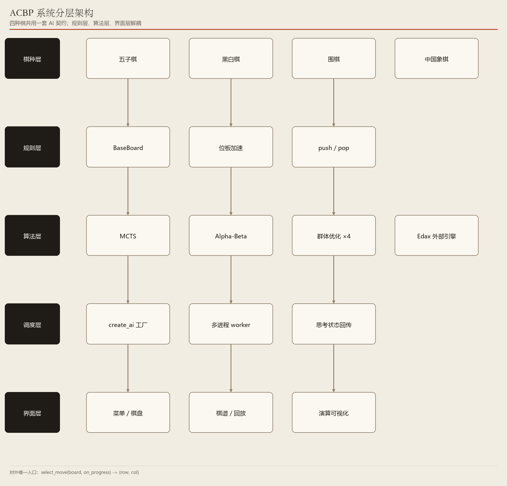
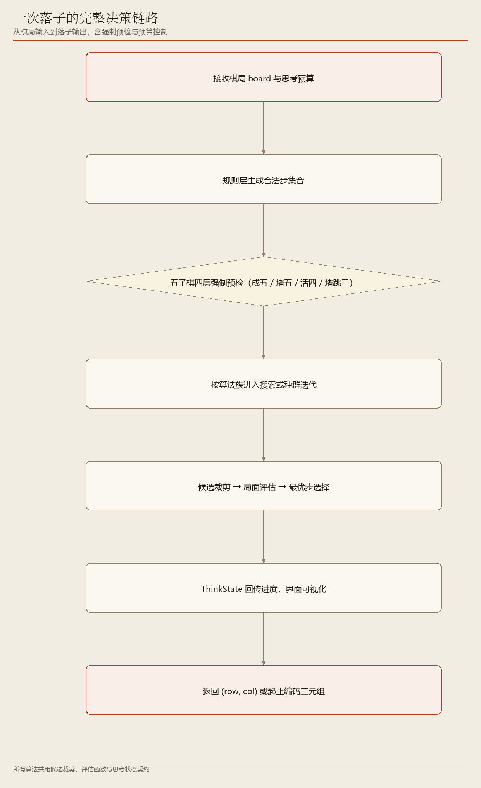

# 00　先看清整张地图：算法体系总览

> 四种棋 · 八类 AI · 一个统一插座

**编号 00　|　难度：入门　|　建议阅读：10 分钟　|　前置：无，第一篇就读它**

[← 返回文档导航](README.md)　|　上一篇：本篇是第 1 篇　|　下一篇：[01 MCTS 蒙特卡洛树搜索](01_MCTS_蒙特卡洛树搜索.md)

> **30 秒速览：** ACBP 是一个棋类对战平台。所有 AI 都遵守同一条规矩：把棋盘交给它，它还你一个落子坐标。规则、算法、界面因此互不干扰，可以像换选手一样换算法。这一篇不讲任何公式，只帮你看懂「谁负责什么」以及「该按什么顺序读后面 9 篇」。

## 这一篇的目录

1. [1. 这一篇讲什么](#1-这一篇讲什么)
2. [2. 先用直觉理解](#2-先用直觉理解)
3. [3. 跟着走一遍：一次落子发生了什么](#3-跟着走一遍一次落子发生了什么)
4. [4. 名词速查](#4-名词速查)
5. [5. 原理、流程图与伪代码](#5-原理流程图与伪代码)
6. [6. 代码在哪儿](#6-代码在哪儿)
7. [7. 动手试一试](#7-动手试一试)
8. [8. 常见疑问与已知限制](#8-常见疑问与已知限制)

---

## 1. 这一篇讲什么

一句话：这是一个把四种棋（五子棋、黑白棋、围棋、中国象棋）和八种 AI 拼装在一起的桌面程序，而让它们能拼起来的关键，是一条极简的统一接口。

读完这一篇，你应该能回答下面三个问题：

- 为什么 MCTS、遗传算法、外部引擎这些完全不同的东西，能塞进同一套对局流程？
- 一次落子从鼠标点击到棋子落下，中间经过了哪几层？
- 后面 9 篇文档我该按什么顺序读，哪几篇可以先跳过？

> **初学者提示：** 本篇是全系列的地图，不要求记住任何术语。遇到看不懂的词，先跳过，第 4 节有速查表，后面每一篇都会重新解释一遍。

## 2. 先用直觉理解

把平台想象成一场棋类比赛：棋盘和规则是「赛场」，界面是「观众席和大屏幕」，AI 是「可以随意更换的选手」。

赛场只认一件事：轮到你了，请给我一个落子位置。至于这位选手是闭眼乱下、在脑子里把后面十步都推演一遍，还是打电话问一位大师，赛场一概不管。

这就是「统一插座」：所有 AI 都长着同一个插头 select_move(board)，棋盘进去、坐标出来。换算法就像换灯泡，不用改线路。

> **初学者提示：** 「接口」听起来抽象，其实就是一句约定：我给你什么、你还我什么。本项目里这个约定是 select_move(board, on_progress=None) → (row, col)。

## 3. 跟着走一遍：一次落子发生了什么

假设你在人机模式里执黑，刚点下一个子，现在轮到 AI 走。

1. 界面把当前棋盘交给对局控制器，并说「轮到白方 AI 了」。
2. 规则层先算出「白方现在所有合法落点」，比如在 8×8 黑白棋里有 7 个。
3. 调度层按你选的算法名字（如 mcts）从工厂取出对应 AI 对象。
4. AI 在给定的时间预算内自己琢磨，期间不断把进度（ thinking 深度、最佳步）回传给界面，于是你能看到进度条和候选点高亮。
5. AI 返回一个坐标，例如 (2, 3)；控制器校验合法后落子。
6. 规则层判断是否终局，界面刷新棋盘，并把这一手写进棋谱。

注意第 4 步：不管里面是 5000 次模拟还是 500 代进化，对外都只是「返回一步」。这就是整个平台最值得先记住的一点。

## 4. 名词速查

| 名词 | 大白话 | 在项目里对应 |
| --- | --- | --- |
| 棋种 / 规则层 | 哪种棋、什么算合法、什么时候算赢 | core/base_board.py 与各 core/*/board.py |
| 算法层 / AI | 负责「下哪一步」的选手 | ai/ 目录，8 种可选算法 |
| 统一接口 | 所有 AI 共用的一进一出约定 | BaseAI.select_move() |
| 工厂 | 按名字（'mcts'）取选手的点名册 | ai/factory.py 的 _REGISTRY |
| 预算 | 允许 AI 想多久 / 想多少次 | config/settings.py 里的 *_TIME_LIMIT、*_ITERATIONS |
| 思考状态 | AI 边想边播报的进度，用来画进度条 | ai/think_state.py 的 ThinkState |
| 棋谱 | 整局落子记录，可回放 | records/ 下的 JSON |
| 强制预检 | 一眼就能赢 / 必须挡的棋，不用搜索直接下 | ai/candidates.py 的 gomoku_forced_move() |

## 5. 原理、流程图与伪代码

> **进阶提醒：** 这一节开始出现架构术语，属于「想改代码时再看」的内容。只想把程序跑起来，可以直接跳到第 7 节。



**图 1　系统分层架构：棋种层 → 规则层 → 算法层 → 调度层 → 界面层**（可编辑 Visio 源：[00_system_arch.vsdx](architecture/00_system_arch.vsdx)）

五层自上而下，但依赖方向是单向的：界面不认识具体算法，算法也不认识界面，双方只通过 ThinkState 回调交换进度。

八种 AI 的分工：mcts 与 alphabeta 是会「推演对手应手」的搜索型；random 是零智力的标尺；iga / de / pso / abc 是四种群体优化，靠「一批候选互相竞争」找步；edax 是黑白棋专用的外部强引擎。



**图 2　一次落子的完整决策链路，含强制预检与预算控制**（可编辑 Visio 源：[00_algo_flow.vsdx](architecture/00_algo_flow.vsdx)）

```python
# 所有 AI 都必须实现的唯一方法（ai/base_ai.py）
def select_move(board, on_progress=None):
    # board: 当前棋盘；on_progress: 可选的进度回调
    # 返回 (row, col)，或 None 表示无合法步
    ...

# 对局层完全不关心对面是谁（ai/factory.py）
ai = create_ai('mcts', player, config)
move = ai.select_move(board, on_progress)
```

中国象棋的走法是「从 A 格走到 B 格」，与「下一个点」不同。项目把它编码成 (from_idx, to_idx) 二元组（idx = row × 9 + col），于是 AI 层、思考状态、棋谱、回放都不需要为象棋单独分叉。

## 6. 代码在哪儿

| 想找什么 | 打开这个文件 | 看什么 |
| --- | --- | --- |
| 程序入口 | start.py | 启动、解析参数、进入主菜单 |
| 所有默认参数 | config/settings.py | 预算、棋种、算法白名单 |
| 命令行参数 | config/args.py | --p1-ai 等参数如何覆盖默认值 |
| AI 统一契约 | ai/base_ai.py | BaseAI.select_move() 与 ThinkState |
| 算法名 → 类 | ai/factory.py | _REGISTRY 注册表 |
| 对局流程 | game/controller.py | 谁落子、何时终局、何时回调 |
| AI 不卡界面 | ui/ai_runner.py | 多进程 worker 与进度回传 |
| 测试 | tests/ | 规则、算法、界面三类冒烟测试 |

## 7. 动手试一试

```python
# 1) 最省事：直接启动，用鼠标在菜单里选
python start.py

# 2) 让两个算法当着你的面对打（五子棋）
python start.py --game gomoku --mode ai_vs_ai --p1-ai mcts --p2-ai alphabeta

# 3) 把预算收紧，观察棋力与思考速度的变化
python start.py --game othello --mode ai_vs_ai --p1-ai alphabeta --p2-ai mcts --ab-depth 4 --mcts-iterations 2000
```

- 改 --ab-depth：数字越大，Alpha-Beta 看得越远，但每一步越慢。
- 改 --mcts-iterations：模拟次数越多，MCTS 统计越稳，同样更慢。
- 改 --seed 为固定整数：同一局可以完整复现，方便对比两种算法。
- 不传任何参数：进入图形主菜单，可以逐个试 8 种 AI。

> **初学者提示：** 本项目没有「简单 / 中等 / 困难」难度档。所有 AI 都按 config/settings.py 里的最大努力预算全力思考；想调强弱，改预算即可。

## 8. 常见疑问与已知限制

**问：我想加一种自己的 AI，要动哪些地方？**

答：最少两步：写一个继承 BaseAI 的类实现 select_move()，再到 ai/factory.py 的 _REGISTRY 里登记名字。若要在菜单里显示，还要补 config/settings.py 的 VALID_AIS 和 ui/main_menu.py 的显示标签。

**问：为什么四种棋能共用同一套 AI？**

答：因为 AI 只依赖规则层提供的三个能力：给我合法步、让我试着落一子、给局面打分。棋种差异全被封装在 core/ 里。

**问：群体优化那四种算法是不是比较弱？**

答：是的。它们不做完备的对抗推演，同预算下整体弱于 Alpha-Beta 与 MCTS，定位是算法 PK 的横向对照与教学演示。

**问：Edax 为什么只在黑白棋里出现？**

答：它是外部黑白棋专用引擎。引擎文件缺失时菜单会自动隐藏；在非黑白棋里被强选时会自动退回 Alpha-Beta。

- 已知限制：搜索型 AI 尚无置换表 / 杀手启发，深度还有提升空间（见第 02 篇）。
- 已知限制：Edax 为 Windows 64 位可执行文件，其它平台需自行编译（见第 08 篇）。
- 文档定位：这 10 篇是学习材料，不是 API 手册；接口细节以源码为准。

---

*ACBP 棋类综合对战平台 · 算法学习文档 · 第 00 篇 / 共 10 篇*
