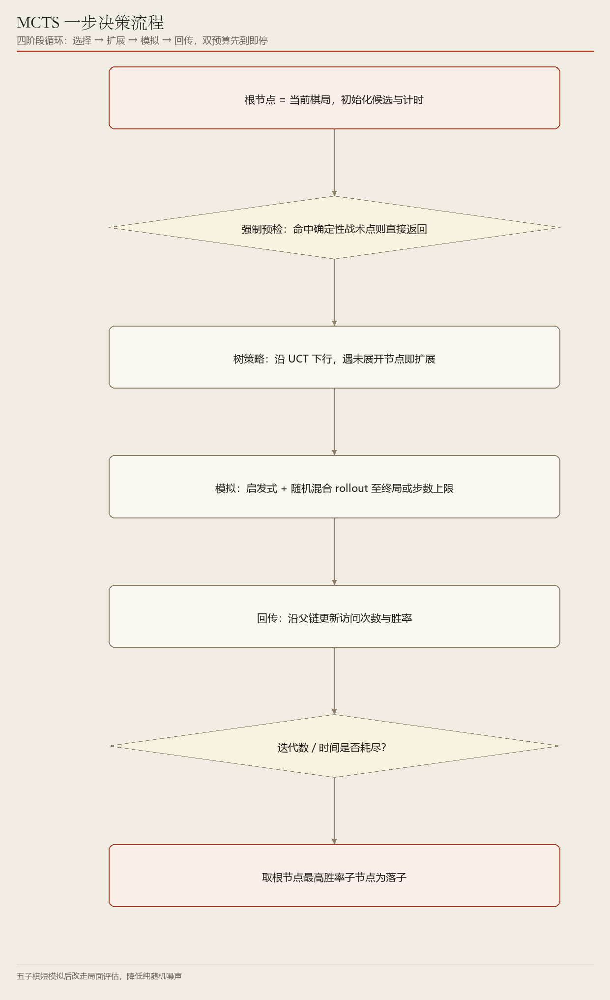
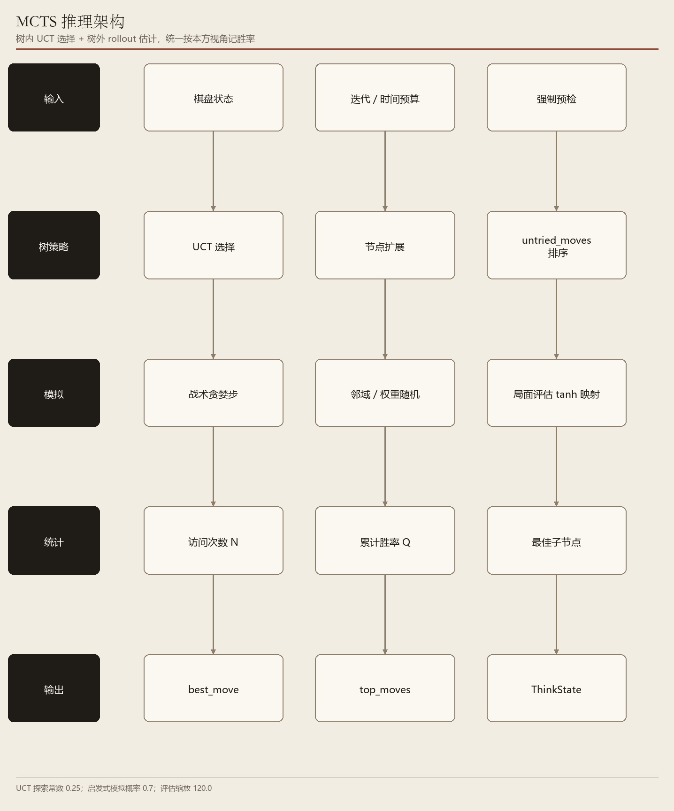

# 01　MCTS：靠「多试几次」下棋

> 选择 → 扩展 → 模拟 → 回传，用统计胜率挑最好的一步

**编号 01　|　难度：进阶　|　建议阅读：14 分钟　|　前置：第 00 篇（统一接口）**

[← 返回文档导航](README.md)　|　上一篇：[00 算法体系总览](00_算法体系总览.md)　|　下一篇：[02 Alpha-Beta 剪枝搜索](02_AlphaBeta_剪枝搜索.md)

> **30 秒速览：** 不知道哪一步好？那就把每一种可能反复「在脑子里下完」，统计各自赢了多少次，最后选胜率最高的那一步。MCTS 把这件事组织成一棵搜索树，用 UCT 公式平衡「试老路」与「探新路」。

## 这一篇的目录

1. [1. 这一篇讲什么](#1-这一篇讲什么)
2. [2. 先用直觉理解](#2-先用直觉理解)
3. [3. 跟着走一遍：三步候选的小例子](#3-跟着走一遍三步候选的小例子)
4. [4. 名词速查](#4-名词速查)
5. [5. 原理、流程图与伪代码](#5-原理流程图与伪代码)
6. [6. 代码在哪儿](#6-代码在哪儿)
7. [7. 动手试一试](#7-动手试一试)
8. [8. 常见疑问与已知限制](#8-常见疑问与已知限制)

---

## 1. 这一篇讲什么

一句话：MCTS 不靠精确推演，而靠大量随机模拟的统计结果来选步。

读完你应该能回答：

- 「模拟一局」到底模拟了什么，和真的下完一局一样吗？
- UCT 公式在解决什么问题，为什么不能只挑当前胜率最高的？
- 为什么项目里还要先做「强制预检」，不直接全部交给 MCTS？

> **初学者提示：** 先记住一个画面：你站在岔路口有 3 条路，不知道哪条通向山顶，于是每条路派 100 个分身去走，哪条回来的人最多，你就走哪条。

## 2. 先用直觉理解

人类棋手遇到陌生局面时，常会说「我大概摆一摆」：假设我走这儿、他大概应那儿、我再走这儿……摆上几遍，凭感觉哪条线舒服就选哪条。MCTS 就是把这件「摆一摆」自动化、并且把「凭感觉」换成「数胜率」。

它有两个朴素的好处：不需要把棋局评估写得极其精确，也不怕分支特别多（围棋、五子棋这种一步有几十上百个候选的局面）。

代价是：模拟本身带随机性，得试够多次结论才稳，所以需要时间预算。

> **初学者提示：** 项目里的模拟并不是「完全随机瞎下」：有 70% 的概率走带战术意识的启发式步，只有 30% 纯随机。这是为了让有限的模拟次数更有价值。

## 3. 跟着走一遍：三步候选的小例子

假设轮到 AI，规则层给出 3 个合法落点 A、B、C，预算是 100 次模拟。

1. 建根：把当前棋盘作为根节点，记下 A / B / C 三个候选，访问次数都为 0。
2. 选择：按 UCT 公式挑一个「值得再试」的候选。一开始大家都是 0，所以先轮着试；试过之后，胜率高但试得少的会被优先再试。
3. 扩展：如果挑到的节点还有没走过的后续走法，就往下挂一个新子节点。
4. 模拟：从这个新局面出发快速下完（或下 12 步后用评估分折算），得到「本方赢面」的一个 0~1 估计值。
5. 回传：把这次结果累加到路径上每个节点的访问次数 N 与累计胜率 Q。
6. 重复第 2—5 步，直到 100 次用完或 10 秒到了（哪个先到都停）。
7. 收官：看根节点三个孩子的胜率，假设 A 为 0.62、B 为 0.48、C 为 0.55，就落 A。

注意第 7 步：最终看的是「最高胜率」，不是「被访问最多」，也不是「累计得分最高」——后者会偏爱试得多的老路。

## 4. 名词速查

| 名词 | 大白话 | 在项目里的取值 / 位置 |
| --- | --- | --- |
| 节点 Node | 树里的一个局面 | _MCTSNode，ai/mcts.py |
| UCT | 决定下一个该试谁：既看胜率，也看试得够不够 | argmax(Q/N + c·√(ln N父 / N子)) |
| 探索常数 c | 越大越爱探新路，越小越爱走老路 | _UCT_EXPLORE = 0.25 |
| Rollout / 模拟 | 从某局面快速下完，估一个输赢 | _rollout()，启发式概率 0.7 |
| 回传 | 把模拟结果记回到路过的所有节点 | _backpropagate() |
| 双预算 | 次数或时间，哪个先到就停 | MCTS_ITERATIONS / MCTS_TIME_LIMIT |
| 强制预检 | 一眼能赢 / 必须挡，直接落子不模拟 | ai/candidates.py 的 gomoku_forced_move() |
| 胜率映射 | 没下完时用局面分折算成 0~1 胜率 | 0.5 + 0.45·tanh(score / 120.0) |

## 5. 原理、流程图与伪代码

> **进阶提醒：** 这一节含公式，属于进阶内容。只想会用、会调参的话，看完图 1 的四个阶段就可以跳到第 7 节。



**图 1　MCTS 一步决策流程：四阶段循环 + 双预算**（可编辑 Visio 源：[01_mcts_flow.vsdx](architecture/01_mcts_flow.vsdx)）

UCT 公式：对每个子节点计算 Q(child)/N(child) + c·√(ln N(parent)/N(child))，取最大者。

前一项是当前平均胜率（ exploitation，利用已知好路），后一项在「这个点试得少」时变大（ exploration，鼓励探索）。项目取 c = 0.25，偏保守、更信任已积累的胜率。

全树统一按「根节点这一方」的视角记胜率，否则子节点的「对方胜率」会让选择方向整个反过来——这是初学实现 MCTS 最常踩的坑。



**图 2　MCTS 推理架构：树内 UCT、树外 rollout、统一的统计与输出**（可编辑 Visio 源：[01_mcts_arch.vsdx](architecture/01_mcts_arch.vsdx)）

```python
while 预算未耗尽:
    node = tree_policy(root)       # UCT 下行，遇未展开节点即扩展
    outcome = rollout(node.state)  # 0~1 的本方胜率估计
    backpropagate(node, outcome)   # 沿父链更新 N 与 Q
return best_child(root).move       # 取根节点最高胜率子节点
```

模拟细节：五子棋只模拟 _ROLLOUT_STEPS = 12 步，期间用「成五 → 堵五 → 成四 → 堵四」的战术贪婪保证双方有基本威胁意识；没分出胜负时，用局面评估分经 0.5 + 0.45·tanh(score/120.0) 折算胜率。黑白棋则模拟到终局，按真实胜负给分。

为什么需要强制预检：一手就能连成五、或者不挡就必胜的局面，是确定性的，不该交给带噪声的统计。项目在搜索前调用公共的四层预检（成五 / 堵成五 / 己方活四 / 堵对手成活四，含跳三补点），命中就直接返回。

## 6. 代码在哪儿

| 文件 | 关键位置 | 作用 |
| --- | --- | --- |
| ai/mcts.py | class MCTSAI、select_move() | 入口：预检 → 循环 → 选最优子节点 |
| ai/mcts.py | class _MCTSNode | 树节点：棋盘副本、untried_moves、N / Q、父子指针 |
| ai/mcts.py | _tree_policy / _expand | UCT 选择与节点扩展 |
| ai/mcts.py | _rollout / _backpropagate | 模拟与结果回传 |
| ai/candidates.py | gomoku_forced_move() | 四层强制预检（所有算法共用） |
| ai/evaluator.py | evaluate() | 未终局时给局面打分 |
| config/settings.py | MCTS_ITERATIONS / MCTS_TIME_LIMIT | 默认 5000 次 / 10.0 秒 |

## 7. 动手试一试

```python
# 让 MCTS 与随机基线对打，先感受「统计确实有用」
python start.py --game gomoku --mode ai_vs_ai --p1-ai mcts --p2-ai random --seed 42

# 把模拟次数从 5000 降到 300，观察胜率与思考时间
python start.py --game gomoku --mode ai_vs_ai --p1-ai mcts --p2-ai random --mcts-iterations 300 --seed 42

# 与 Alpha-Beta 同预算对比（五子棋上 AB 通常更强）
python start.py --game gomoku --mode ai_vs_ai --p1-ai mcts --p2-ai alphabeta --mcts-time 10 --ab-time 10
```

| 参数 | 默认值 | 调大之后会看到什么 |
| --- | --- | --- |
| --mcts-iterations | 5000 | 统计更稳、走法更可靠，但每步更慢 |
| --mcts-time | 10.0 秒 | 与次数构成双预算，先到即停 |
| _UCT_EXPLORE（源码常量） | 0.25 | 调大更爱探索生僻走法，调小更保守 |
| _HEURISTIC_ROLLOUT_PROB | 0.7 | 调低会让模拟更随机、噪声更大 |

> **初学者提示：** 想复现同一局，一定加 --seed 42（任意整数均可）。否则随机模拟每局都不同，比较两种参数时容易被噪声误导。

## 8. 常见疑问与已知限制

**问：模拟到终局不就行了，为什么要只模拟 12 步？**

答：五子棋一局可能几十手，完整模拟太慢；短模拟后用评估分折算胜率，是用一点精度换大量次数，统计上更划算。

**问：为什么访问次数最多的点不是最终选择？**

答：访问次数多只说明 UCT 觉得它「值得反复确认」，最终决策看平均胜率 Q/N，避免把票投给试得多但赢面一般的点。

**问：MCTS 和 Alpha-Beta 谁更强？**

答：看棋种。五子棋有很强的领域启发式，同 10 秒预算下本项目 Alpha-Beta 通常更强；分支极大、评估难写的棋种 MCTS 更有优势。

- 已知限制：每个树节点保存一份棋盘副本，内存随迭代次数增长。
- 已知限制：没有置换表与 RAVE 等加速，模拟质量依赖启发式 rollout。
- 边界：无合法步时与其它算法一样返回 None，由对局层按棋种规则处理。

---

*ACBP 棋类综合对战平台 · 算法学习文档 · 第 01 篇 / 共 10 篇*
