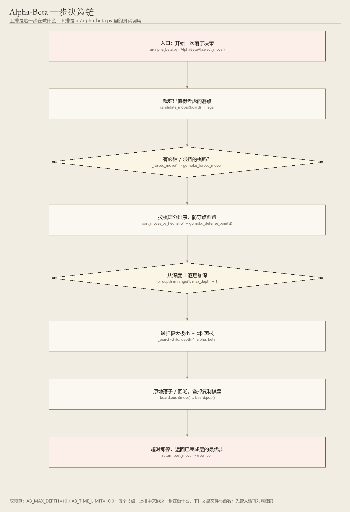
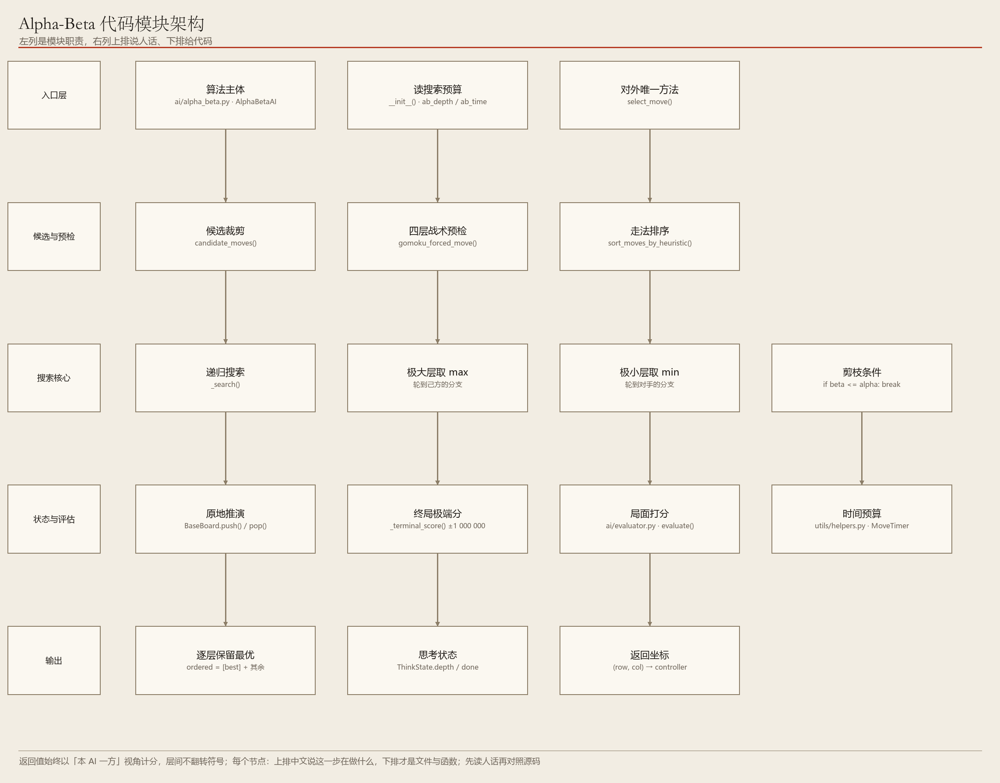

# 02　Alpha-Beta：把对手也算进去

> 极大极小 + αβ 剪枝 + 迭代加深，逐行读 `ai/alpha_beta.py`

**编号 02　|　难度：进阶　|　建议阅读：32 分钟　|　前置：第 00 篇（调用链）、第 01 篇（候选裁剪与预检）**

[← 返回文档导航](README.md)　|　上一篇：[01 MCTS 蒙特卡洛树搜索](01_MCTS_蒙特卡洛树搜索.md)　|　下一篇：[03 随机基线](03_Random_随机基线.md)

> **30 秒速览：** 下棋不能只挑「我走完最好」的那一步，还得假设对手会挑「对我最不利」的应手。Alpha-Beta 把「我取最大、对手取最小」一层层递归下去，并在发现某条分支已被证明不可能更优时立刻停算（剪枝）。这一篇逐段读 `ai/alpha_beta.py`，把预算、排序、迭代加深、`_search()` 的极大/极小层、以及 `push/pop` 原地推演都讲清楚。

> **源码快照说明：** 代码片段基于 **2026-11-10** 源码，均为**节选**；行号仅供对照，**函数名才是稳定定位**。

## 这一篇的目录

1. [1. 这一篇讲什么](#1-这一篇讲什么)
2. [2. 先用直觉理解](#2-先用直觉理解)
3. [3. 跟着代码走一遍](#3-跟着代码走一遍)
4. [4. 名词速查](#4-名词速查)
5. [5. 源码逐段精读](#5-源码逐段精读)
6. [6. 代码模块地图](#6-代码模块地图)
7. [7. 动手试一试](#7-动手试一试)
8. [8. 常见疑问与已知限制](#8-常见疑问与已知限制)

---

## 1. 这一篇讲什么

一句话：Alpha-Beta 是一种「把双方最优应对都算进去」的确定性搜索，靠剪枝把不必看的分支提前砍掉。

读完你应该能回答：

- 为什么不能只挑「我走完后局面分最高」的那一步？
- `alpha` 和 `beta` 各代表什么，凭什么能安全地 `break`？
- 「迭代加深」和 `push/pop` 分别解决什么问题？**根节点层和递归层用的还是同一招吗？**（答案：不是）

**这一篇会带你读的文件：** `ai/alpha_beta.py`（主体）、`ai/candidates.py`、`ai/evaluator.py`、`core/base_board.py`、`utils/helpers.py`、`config/settings.py`。

> **初学者提示：** 第 2 节不用记术语；第 3 节是核心，把每个英文函数翻成中文并讲清输入输出；第 5 节才逐行摊开源码。

## 2. 先用直觉理解

想象你在挑晚饭去处，有三家店 A、B、C。你不能只看「我最喜欢哪家」，因为同行的朋友有一票否决权：你选 A，他会挑 A 里最差的菜；选 B，他挑 B 里最差的菜。正确做法是先算清每家店「最坏能差到什么程度」，再在这些最坏结果里挑最好的一家。

棋局同理：我走一步（希望分数最大），对手应一步（会把分数压到最小），我再走一步……这就是**极大极小**。

**剪枝**则像逛店逛到一半：你已经知道 B 店最坏也有 80 分，而 A 店刚发现有一道菜只有 30 分、朋友一定会点它，那么 A 店剩下什么菜都不用看了。这不是「猜」，是**已经证明它不可能更好**。

> **初学者提示：** 「分」是 `ai/evaluator.py · evaluate()` 给局面的一个数字，正数对我有利；赢棋直接给 ±1 000 000 的极端分，压过任何中盘评分。

## 3. 跟着代码走一遍

> **这一节是整篇最关键的部分。** 假设轮到 AI，有 3 个候选落点 A、B、C，最大深度 10 层、时间上限 10 秒。下面按真实执行顺序走 8 步，每步都讲清「在干什么 / 函数具体做什么 / 输入输出 / 为什么」。

### 先收好这张「函数名对照表」

| 函数名（英文） | 中文作用（它到底干了什么） | 输入 → 输出 |
| --- | --- | --- |
| `AlphaBetaAI.select_move()` | 总入口：预检 → 排序 → 逐层加深 → 返回最优步 | 棋盘 + 回调 → `(row, col)` |
| `candidate_moves()` | 取合法步，五子棋再裁剪到已有棋子 2 格邻域内 | 棋盘 → 坐标列表 `legal` |
| `sort_moves_by_heuristic()` | 按棋理分给候选步排序，好步排前面 | 棋盘 + 候选 → 排好序的列表 |
| `gomoku_defense_points()` | 找出对手活三 / 跳三的必堵点 | 棋盘 + 本方 → 坐标列表 |
| `gomoku_forced_move()` | 四层确定性预检：成五 / 堵五 / 活四 / 堵活四 | 棋盘 + 本方 → `(坐标, 提示)` 或 `None` |
| `MoveTimer` | 计时器，`timeout` 回答「时间到了没」 | 秒数 → `True/False` |
| `_search()` | 递归核心：极大层取 max、极小层取 min，并做 αβ 剪枝 | 局面 + 深度 + α/β → 分数 |
| `board.push()` / `pop()` | 原地落子 / 撤销，代替复制整个棋盘 | 一步棋 → 棋盘状态改变 / 复原 |
| `evaluate()` | 到达深度上限时给局面打分 | 局面 + 本方 → 分数 |
| `_terminal_score()` | 终局给极端分：赢 +100 万、输 −100 万、平 0 | 终局棋盘 → 分数 |
| `_emit()` | 把 `ThinkState` 推给界面，画进度条与当前最佳步 | 思考状态 → 无 |
| `_begin_think()` | 清空上一轮思考状态 | 无 → 重置 `ThinkState` |

### 第 1 步：入口先拿候选，并确认还能下

**在干什么：** 得到当前局面值得考虑的落点。

**函数具体做什么：** `AlphaBetaAI.select_move()` 第一句 `legal = candidate_moves(board)`。它先调 `board.get_legal_moves()`，五子棋再只保留已有棋子 2 格邻域内的空位（空盘给中心四点），把分支从 200+ 降到 40~80；黑白棋 / 象棋合法步本来就少，原样返回。

**输入 → 输出：** `board` → `legal = [(7,7), (7,8), (6,7)]`；为空则 `return None`（无合法步，交给对局层按棋种处理）。

**为什么：** 深度 10 的搜索对分支数极其敏感，先裁剪是能算得动的前提。

### 第 2 步：把「这次思考」的状态和预算准备好

**在干什么：** 重置进度条，读入深度与时间上限。

**函数具体做什么：** 构造函数 `__init__()` 里 `self.max_depth = max(1, int(config.ab_depth))`（默认 10）、`self.time_limit = float(config.ab_time)`（默认 10.0）、`self._nodes = 0`（已评估节点数）。`select_move()` 里调 `_begin_think()` 清空 `ThinkState`，再设 `think.total = think.max_depth = self.max_depth`，进度条才知道「一共要加深到几层」。

**输入 → 输出：** `cfg.ab_depth = 10`、`cfg.ab_time = 10.0` → 搜索预算；`think.total = 10`。

**为什么：** 与 MCTS 的「次数 + 时间」不同，这里的主力刹车是**深度**和**时间**，迭代加深逐层推进。

### 第 3 步：先问「有没有一眼就该下的棋」

**在干什么：** 一手成五或必须挡的棋，不用搜索，直接下。

**函数具体做什么：** `_forced_move(board)` 转发给 `ai/candidates.py · gomoku_forced_move()`，按四层优先级判断（己方成五 → 堵对手成五 → 己方活四 → 堵对手活四，含跳三补点）。命中返回 `(坐标, 中文提示)`，源码会把提示写进 `think.note`、设 `phase = "强制预检"`、推一次进度后**直接返回**。

**输入 → 输出：** 当前棋盘 + 本方编号 → `((7,8), "检测到对手成五点，强制防守")`，或 `None`。

**为什么：** 确定性战术结论比启发式评分可靠，且不该浪费搜索预算。这段逻辑 MCTS、Alpha-Beta、进化类**共用同一份**，避免各自漂移。

### 第 4 步：把候选排好序，防守点放最前

**在干什么：** 决定「先算哪一步」，顺序直接决定剪枝效率。

**函数具体做什么：** `ordered = sort_moves_by_heuristic(board, legal, self.player)` 按棋理分降序排（实现在 `ai/candidates.py` 第 308 行，key 是 `-move_heuristic_score(...)`）。若是五子棋，再调 `gomoku_defense_points()` 把必堵点用列表推导挪到最前面。源码随后设 `best_move = ordered[0]` 作为「万一一步都没算完」的兜底。

**输入 → 输出：** `legal` → `ordered`，例如 `[(7,8), (7,7), (6,7)]`。

**为什么：** αβ 剪枝的效率极度依赖顺序——先算到好步，`alpha` 才能尽早抬高，后面大量分支才能被砍掉。同样的深度，排序好坏可能差好几倍耗时。

### 第 5 步：从深度 1 开始逐层加深

**在干什么：** 不一口气搜到 10 层，而是 1、2、3……层地算，随时可以安全停下。

**函数具体做什么：** `for depth in range(1, self.max_depth + 1)`，每层开头先 `if timer.timeout: break`；层内对每个候选做一次试算，得到该层最优 `layer_best_move / layer_best_score`；层末把上一层最优步移到 `ordered` 最前面（`ordered = [layer_best_move] + [其余]`），让下一层优先算它。每完成一层就更新 `ThinkState.depth / done / best_move / best_value / elapsed / phase` 并 `_emit()`。

**输入 → 输出：** 第 3 层算完 → `think.phase = "迭代加深 · 第 3 层"`、`best_move = (7,8)`；时间到则保留第 3 层的完整结论。

**为什么：** 时间预算不可预测，逐层加深保证「返回的永远是某一层完整算完的结果」，不会用到算了一半的层；上一层最优步还能改善下一层的排序。

### 第 6 步：递归里分「我走」和「对手走」两种层

**在干什么：** 真正把双方的最优应对推演出来。

**函数具体做什么：** `_search(board, depth, alpha, beta)` 先把 `_nodes += 1`；若 `board.game_over` 返回 `_terminal_score()`；若 `depth == 0` 返回 `evaluate(board, self.player)`；否则重新 `candidate_moves()` + `sort_moves_by_heuristic()`。然后按 `board.current_player == self.player` 分流：**极大层** `best = -inf`，逐分支取 `max(best, score)` 并 `alpha = max(alpha, best)`；**极小层** `best = inf`，取 `min` 并 `beta = min(beta, best)`。返回值**始终以本 AI 一方视角计分**，层间不翻转符号。

**输入 → 输出：** 局面 + `depth=3` + `alpha=-inf` + `beta=inf` → 一个分数，例如 `+120.5`。

**为什么：** 「对手会挑对我最不利的一手」必须显式建模，否则评估分只反映「我自嗨」的局面。

### 第 7 步：原地落子与回溯，并在能证明时剪枝

**在干什么：** 推演每一步后把棋盘还原，同时跳过已无用分支。

**函数具体做什么：** 递归内部用 `board.push(move)` 原地落子 → `try: score = _search(...)` → `finally: board.pop()` 还原（`try/finally` 保证异常也不残留脏状态）。每层算完检查 `if beta <= alpha: break`：极大层里 `beta` 是「已知对手至多让我拿到的上界」，一旦 `alpha ≥ beta`，后续分支再好也不会被对手允许，可以安全跳过；极小层同理。

**输入 → 输出：** 一个分支 → 一个分数 + 棋盘完好复原；触发剪枝时该层剩余候选不再计算，`_nodes` 明显小于理论分支数。

**为什么：** `push/pop` 省掉「每个分支复制整个棋盘 + 重复合法性校验」（象棋构造器还会重摆 32 枚棋子）；剪枝则让实际搜索节点数远小于理论值。**注意**：根节点那一层（`select_move()` 第 91 行）仍用 `child = board.copy(); child.apply_move(move)`，只有 `_search()` 内部才换成 `push/pop`，两处并不相同。

### 第 8 步：收尾，把坐标交回对局层

**在干什么：** 超时或算满深度后，返回当前最优步。

**函数具体做什么：** 循环结束后 `log_debug()` 打印深度、节点数、选中步与评分（仅 `--debug` 时可见），`self.think.finish()` 收尾，`return best_move`。这个坐标由 `game/controller.py · apply_ai_move()` 校验后落到真实棋盘（见第 00 篇 5.6）。

**输入 → 输出：** 迭代加深的最终 `best_move` → `(7, 8)`。

**为什么：** 算法层只返回坐标，不碰真实棋盘、不碰界面，这是统一插座的约定。

> **一句话记住整条链：** 裁剪候选 → 四层预检 → 启发式排序 → 从深度 1 逐层加深 → 层内递归 `_search()`（我取 max / 对手取 min + `β ≤ α` 剪枝 + `push/pop`）→ 每完成一层播报进度 → 返回最优步。
>
> 上面每一步的**真实源码片段与逐行解释**在第 5 节；图 1 就是这 8 步的调用链。

## 4. 名词速查

| 名词 | 大白话 | 在项目里的取值 / 位置 |
| --- | --- | --- |
| 极大层 / 极小层 | 轮到我取最大，轮到对手取最小 | `ai/alpha_beta.py · _search()` |
| `alpha` | 我方目前「至少能拿到」的分数下界 | 随搜索 `max(alpha, best)` 更新 |
| `beta` | 对手目前「至多让我拿到」的分数上界 | 随搜索 `min(beta, best)` 更新 |
| 剪枝 | 已证明某分支不可能更优，直接不看 | `if beta <= alpha: break` |
| 迭代加深 | 从 1 层逐层算到预算用完 | `for depth in range(1, max_depth + 1)` |
| `push` / `pop` | 原地落子与撤销，代替复制棋盘 | `core/base_board.py · BaseBoard` |
| 终局分 | 赢 / 输 / 平的极端分 | `_WIN_SCORE = 1 000 000` / `_LOSE_SCORE = -1 000 000` |
| 走法排序 | 先算最有希望的分支，让剪枝更早发生 | `sort_moves_by_heuristic()` |
| 双预算 | 深度或时间，先到即停 | `AB_MAX_DEPTH = 10` / `AB_TIME_LIMIT = 10.0` |

## 5. 源码逐段精读

> **进阶提醒：** 按 `ai/alpha_beta.py` 的实际结构展开，建议把源码放在旁边。只想会用、会调参，看完两张图和 5.2 就可以跳到第 7 节。



**图 1　代码调用链**（可编辑 Visio 源：[02_ab_flow.vsdx](architecture/02_ab_flow.vsdx)）



**图 2　代码模块架构**（可编辑 Visio 源：[02_ab_arch.vsdx](architecture/02_ab_arch.vsdx)）

**怎么读这两张图：** 每个节点**上排是中文动作说明**（这一步在做什么、为什么要做），**下排才是文件与函数定位**。例如「按棋理分排序，防守点前置」下面写的是 `sort_moves_by_heuristic() + gomoku_defense_points()`。先读上排理解流程，再看下排找源码。两张图的 PNG 与 VSDX 由同一份节点定义生成，文字完全一致。

### 5.1 常量与构造函数

**定位：`ai/alpha_beta.py` 第 28—45 行（节选）**

```python
_WIN_SCORE = 1_000_000
_LOSE_SCORE = -1_000_000

def __init__(self, player, config) -> None:
    super().__init__(player, config)
    self.max_depth = max(1, int(config.ab_depth))
    self.time_limit = float(config.ab_time)
    self._nodes = 0
```

**逐行看懂：**

1. 终局分取 ±100 万，远大于任何中盘启发式评分，保证「真赢了」永远压过「局面看着不错」。
2. `config.ab_depth` / `config.ab_time` 来自 `config/args.py · load_config()`，默认 10 层 / 10.0 秒；`max(1, ...)` 保证至少搜一层。
3. `_nodes` 是已评估节点数，既写进 `ThinkState.done` 画进度，也用于 `--debug` 日志。**加 `--debug` 对比深度 4 与 6 的节点数，能直观看到剪枝效果**。

### 5.2 `select_move()`：预检、排序、迭代加深

**定位：第 49—118 行（分成三段节选）**

```python
legal = candidate_moves(board)
if not legal:
    return None
self._begin_think()
self.think.total = self.max_depth
self.think.max_depth = self.max_depth
self._nodes = 0

quick_move = self._forced_move(board)
if quick_move is not None:
    self.think.best_move = quick_move
    self.think.phase = "强制预检"
    self._emit(on_progress)
    self.think.finish()
    return quick_move
```

预检命中时也要 `_emit()` + `finish()`，否则界面进度条会停在半路。

```python
ordered = sort_moves_by_heuristic(board, legal, self.player)
if type(board).__name__ == "GomokuBoard":
    defs = gomoku_defense_points(board, self.player)
    if defs:
        ordered = ([m for m in defs if m in ordered]
                   + [m for m in ordered if m not in defs])
best_move = ordered[0]
timer = MoveTimer(self.time_limit)
timer.start()
```

`best_move = ordered[0]` 是兜底初值：即使时间瞬间耗尽，也能返回一个排序最高的合法步。

```python
for depth in range(1, self.max_depth + 1):
    if timer.timeout:
        break
    alpha, beta = -math.inf, math.inf
    layer_best_move, layer_best_score = ordered[0], -math.inf

    for move in ordered:
        child = board.copy()                 # ← 根节点层仍是复制棋盘
        child.apply_move(move)
        score = self._search(child, depth - 1, alpha, beta)
        if score > layer_best_score:
            layer_best_score, layer_best_move = score, move
        if score > alpha:
            alpha = score
        if timer.timeout:
            break

    best_move, best_score = layer_best_move, layer_best_score
    ordered = [m for m in ordered if m != layer_best_move] or ordered
    ordered = [layer_best_move] + ordered
    self.think.depth = depth
    self.think.done = self._nodes
    self.think.best_move = best_move
    self.think.phase = f"迭代加深 · 第 {depth} 层"
    self._emit(on_progress)
```

**逐行看懂：**

1. 每层重新把 `alpha/beta` 置为 ±无穷（层与层之间不复用窗口，本项目没有 aspiration 窗口）。
2. **根节点层用 `board.copy()`**：这里每个候选只复制一次，代码简单；真正高频的分支在递归内部，那里才换成 `push/pop`（见 5.3）。旧版文档把这点写成「每个分支都不再 copy」，与源码不符，这里更正。
3. `ordered = [layer_best_move] + 其余` 把上一轮最优步顶到最前，下一层优先算它——排序越好，剪枝越早触发。
4. 层内也检查 `timer.timeout`，超时立即停，但**已完整算完的前几层结论保留**。

### 5.3 `_search()`：极大层、极小层与剪枝

**定位：第 136—189 行（节选）**

```python
def _search(self, board, depth, alpha, beta) -> float:
    self._nodes += 1
    if board.game_over:
        return self._terminal_score(board)
    if depth == 0:
        return evaluate(board, self.player)
    legal = candidate_moves(board)
    if not legal:
        return evaluate(board, self.player)
    ordered = sort_moves_by_heuristic(board, legal, board.current_player)

    if board.current_player == self.player:      # 极大层
        best = -math.inf
        for move in ordered:
            if not board.push(move):
                continue
            try:
                score = self._search(board, depth - 1, alpha, beta)
            finally:
                board.pop()
            best = max(best, score)
            alpha = max(alpha, best)
            if beta <= alpha:
                break
        return best
    else:                                        # 极小层
        best = math.inf
        for move in ordered:
            if not board.push(move):
                continue
            try:
                score = self._search(board, depth - 1, alpha, beta)
            finally:
                board.pop()
            best = min(best, score)
            beta = min(beta, best)
            if beta <= alpha:
                break
        return best
```

**逐行看懂：**

1. 三个提前返回：终局用极端分、到深度用评估分、**当前方无合法步也用评估分**（黑白棋跳回合时不会把递归卡死）。
2. 判断「轮到谁」用的是 `board.current_player == self.player`，因此**不需要在层间翻转符号**，比常见的 negamax 写法更好读。
3. `push(move)` 返回 False（落子失败）就 `continue`，不进入递归。
4. `try/finally` 是必须的：递归里任何异常都会让棋盘留在「已落子」状态，后续全盘皆错。
5. `beta <= alpha` 的含义：极大层里 `alpha` 已抬高到不低于对手允许的上界 `beta`，继续算下去也不会改变父层选择；极小层对称。

### 5.4 终局打分与 `push/pop` 的底层

**定位：`ai/alpha_beta.py` 第 191—198 行 + `core/base_board.py` 第 165—195 行（节选）**

```python
def _terminal_score(self, board) -> float:
    opponent = board.opponent(self.player)
    if board.winner == self.player:
        return _WIN_SCORE
    if board.winner == opponent:
        return _LOSE_SCORE
    return 0.0
```

```python
def _snapshot(self) -> tuple:
    return ([row[:] for row in self.board],
            self.current_player, self.last_move, self.move_count,
            self.game_over, self.winner, len(self.history))

def push(self, move) -> bool:
    snap = self._snapshot()
    if not self._apply_unchecked(move):
        return False
    self._undo_stack.append(snap)
    return True

def pop(self) -> bool:
    if not self._undo_stack:
        return False
    self._restore(self._undo_stack.pop())
    return True
```

**逐行看懂：** 快照是**行拷贝**（`row[:]`）加几个标量，比 `copy()` 构造整个对象轻得多；`_apply_unchecked()` 跳过重复合法性校验（候选本来就来自合法集合）。围棋 / 象棋子类会往快照里追加劫点、提子数、连续重复走法计数等额外状态，并覆盖 `_restore()`。完整讲解见第 09 篇。

### 5.5 本节小结：把函数名串起来

```
game/controller.py · step_ai()
  └─ ai/alpha_beta.py · AlphaBetaAI.select_move(board, on_progress)
     ├─ ai/candidates.py · candidate_moves(board) → legal
     ├─ _forced_move() → gomoku_forced_move()          （命中直接返回）
     ├─ sort_moves_by_heuristic() + gomoku_defense_points() → ordered
     ├─ utils/helpers.py · MoveTimer                    （深度 + 时间双预算）
     ├─ for depth in 1..AB_MAX_DEPTH:
     │    └─ 每个候选：board.copy() → _search(child, depth-1, alpha, beta)
     │         ├─ 终局 → _terminal_score()
     │         ├─ depth==0 → ai/evaluator.py · evaluate()
     │         ├─ 极大层 max / 极小层 min + if beta <= alpha: break
     │         └─ core/base_board.py · board.push() / pop()（try/finally）
     ├─ ai/base_ai.py · _emit() → 界面进度条
     └─ return best_move → (row, col)
```

| 常量 / 字段 | 定义处 | 含义 |
| --- | --- | --- |
| `_WIN_SCORE` / `_LOSE_SCORE` | 第 29—30 行 | ±1 000 000，终局极端分 |
| `self.max_depth` | `__init__()` | 来自 `ab_depth`，默认 10 |
| `self.time_limit` | `__init__()` | 来自 `ab_time`，默认 10.0 秒 |
| `self._nodes` | `__init__()` | 已评估节点数 |
| `alpha` / `beta` | `select_move()` 每层 | 分数下界 / 上界 |

## 6. 代码模块地图

| 文件 | 类 / 函数 | 作用 | 被谁调用 | 建议读码顺序 |
| --- | --- | --- | --- | --- |
| `game/controller.py` | `step_ai()` | 触发一次 AI 回合 | 界面主循环 | ① |
| `ai/alpha_beta.py` | `AlphaBetaAI.__init__()` | 读入深度与时间预算 | `create_ai()` | ② |
| `ai/alpha_beta.py` | `select_move()` | 主流程：预检 → 排序 → 迭代加深 | `step_ai()` | ③ |
| `ai/alpha_beta.py` | `_forced_move()` | 转发到公共四层预检 | `select_move()` | ④ |
| `ai/candidates.py` | `candidate_moves()` / `sort_moves_by_heuristic()` / `gomoku_defense_points()` | 裁剪、排序、防守点 | `select_move()`、`_search()` | ⑤ |
| `ai/alpha_beta.py` | `_search()` | 递归极大极小 + αβ 剪枝 | `select_move()` 与自身递归 | ⑥ |
| `ai/alpha_beta.py` | `_terminal_score()` | 终局极端分 | `_search()` | ⑦ |
| `ai/evaluator.py` | `evaluate()` | 到深度上限时给局面打分 | `_search()` | ⑧ |
| `core/base_board.py` | `push()` / `pop()` / `_snapshot()` | 原地推演与撤销 | `_search()` | ⑨ |
| `utils/helpers.py` | `MoveTimer` | 时间预算判定 | `select_move()` | ⑩ |
| `config/settings.py` | `AB_MAX_DEPTH` / `AB_TIME_LIMIT` | 默认 10 / 10.0 | `load_config()` | ⑪ |

**推荐读码路线：** 先读 ③ 的 `select_move()` 把握主干（它本身就是一份流程说明书），再读 ⑥ 的 `_search()` 看两个分支如何对称，然后跳 ⑤ ⑧ ⑨ 查外部依赖，最后回 ① 看是谁启动的（第 00 篇已讲）。

## 7. 动手试一试

```bash
# 深度 2 与深度 8 对比：看棋力与每步耗时的变化
python start.py --game gomoku --mode ai_vs_ai --p1-ai alphabeta --p2-ai random --ab-depth 2 --seed 7
python start.py --game gomoku --mode ai_vs_ai --p1-ai alphabeta --p2-ai random --ab-depth 8 --seed 7

# 打开调试日志，观察 5.1 的 _nodes（搜索节点数）随深度怎么变
python start.py --game gomoku --mode ai_vs_ai --p1-ai alphabeta --p2-ai random --ab-depth 6 --debug

# 与 MCTS 同预算对比
python start.py --game othello --mode ai_vs_ai --p1-ai alphabeta --p2-ai mcts --ab-time 10 --mcts-time 10
```

| 参数 | 默认值 | 调大之后会看到什么 |
| --- | --- | --- |
| `--ab-depth` | 10 层 | 看得更远、棋力更强，耗时近似指数增长 |
| `--ab-time` | 10.0 秒 | 超时立即返回已完成深度的结果，不会白算 |
| `--seed` | 不固定 | 固定后同一局可复现，便于公平比较 |
| `--debug` | 关闭 | 打印深度、节点数、选中步与评分 |

> **初学者提示：** 想直观看到剪枝，把 `--debug` 打开、深度从 4 调到 6，观察节点数远小于「候选数^深度」的理论值。比较两种参数时务必加 `--seed`。

## 8. 常见疑问与已知限制

**问：剪掉分支会不会漏掉妙手？**

答：不会。`beta <= alpha` 的前提是已经数学证明「这条分支的最好结果也不可能超过现有选择」，砍掉的是不影响最终决策的计算，不是砍掉可能性。

**问：为什么一定要先做走法排序？**

答：见 5.2。αβ 剪枝的效率极度依赖顺序：先算到好步，`alpha/beta` 才能尽早收紧。同样的深度，排序好坏可能差好几倍耗时。

**问：超时了会不会返回半截结果？**

答：不会。迭代加深保证每一层完整算完才更新 `best_move`，超时只返回最后完整算完的那一层；层内超时也只用已完成层的结论。

**问：根节点层和递归层都用 `push/pop` 吗？**

答：**不是**。`select_move()` 第 91 行根节点层仍用 `child = board.copy(); child.apply_move(move)`；只有 `_search()` 内部（第 164、179 行）才换成 `push/pop`。旧版文档把这点写反了，此处以源码为准。

**问：`alpha` 和 `beta` 为什么不翻转符号？**

答：因为 `_search()` 的返回值始终以 `self.player` 视角计分。极大层是我方回合取 max，极小层是对手回合取 min，无需 negamax 那种逐层取负。

- 已知限制：尚无 Zobrist 置换表、杀手 / 历史启发、aspiration 窗口；补齐后同预算可再深 2~4 层。
- 已知限制：评估函数是手写启发式（`ai/evaluator.py`），棋力上限取决于它。
- 已知限制：没有跨回合复用搜索结果，每步从头算。
- 文档定位：代码片段是节选，完整实现请以 `ai/alpha_beta.py` 为准。

---

*ACBP 棋类综合对战平台 · 算法学习文档 · 第 02 篇 / 共 10 篇 · 代码片段基于 2026-11-10 源码*
