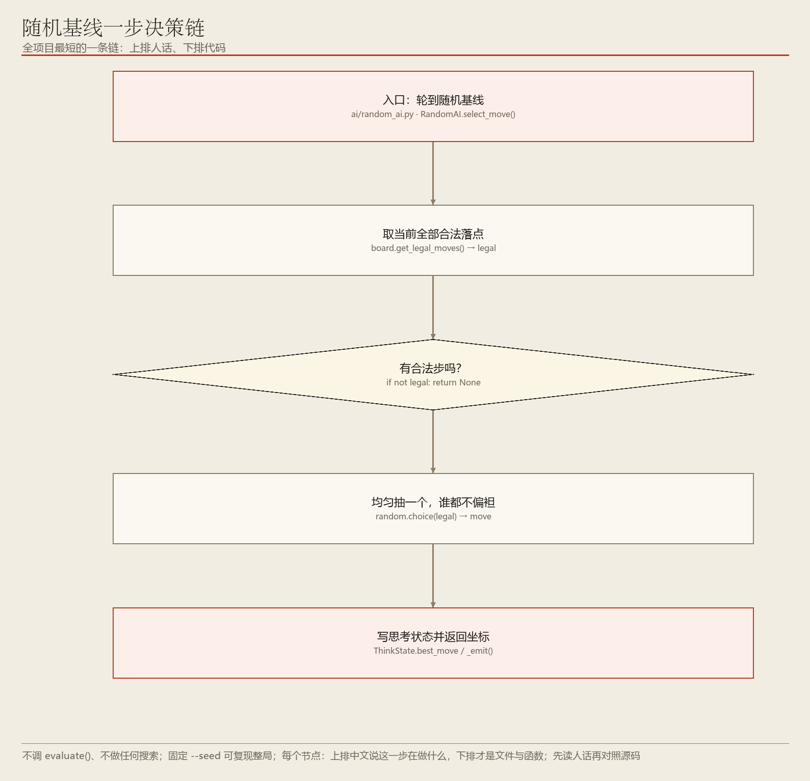
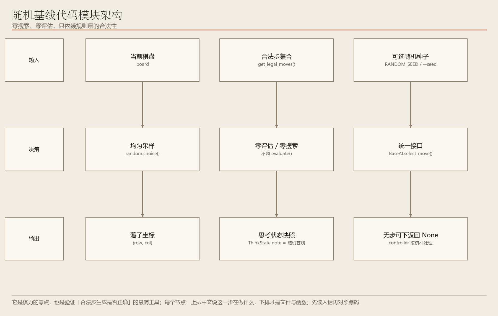

# 03　随机基线：一把量棋力的尺子

> 不评估、不搜索，只从合法步里均匀抽一个；逐行读 `ai/random_ai.py`

**编号 03　|　难度：入门　|　建议阅读：14 分钟　|　前置：第 00 篇（统一接口）**

[← 返回文档导航](README.md)　|　上一篇：[02 Alpha-Beta 剪枝搜索](02_AlphaBeta_剪枝搜索.md)　|　下一篇：[04 IGA 改进遗传算法](04_IGA_改进遗传算法.md)

> **30 秒速览：** 最笨的 AI：闭着眼从合法落点里随便挑一个。它存在的意义不是赢棋，而是当「零点」——验证流程能不能跑通、标定其它算法到底比瞎下强多少。这一篇会把 `ai/random_ai.py` 的**全部 34 行**逐行读完，并追到 `get_legal_moves()`、`random.choice()`、`--seed` 生效的地方，是练习「读源码」最好的起点。

> **源码快照说明：** 代码片段基于 **2026-11-10** 源码；行号仅供对照，**函数名才是稳定定位**。

## 这一篇的目录

1. [1. 这一篇讲什么](#1-这一篇讲什么)
2. [2. 先用直觉理解](#2-先用直觉理解)
3. [3. 跟着代码走一遍](#3-跟着代码走一遍)
4. [4. 名词速查](#4-名词速查)
5. [5. 源码逐段精读](#5-源码逐段精读)
6. [6. 代码模块地图](#6-代码模块地图)
7. [7. 动手试一试](#7-动手试一试)
8. [8. 常见疑问与已知限制](#8-常见疑问与已知限制)

---

## 1. 这一篇讲什么

一句话：随机基线是整个平台最简单、也最有用的对照工具。

读完你应该能回答：

- 一个「什么都不会」的 AI，为什么值得专门写一篇？
- 它是怎么做到**永远不走出非法步**的？
- `--seed 42` 到底在哪里生效，为什么能复现整局？
- 没有合法步时（黑白棋被迫停一手）它会返回什么？

**这一篇会带你读的文件：** `ai/random_ai.py`（全部）、`ai/base_ai.py`、`ai/think_state.py`、`core/base_board.py`、`core/othello/board.py`（合法步示例）、`config/args.py`（种子生效处）、`game/controller.py`。

> **初学者提示：** 这是全系列最容易读的一篇。文件只有 34 行，建议真的打开 `ai/random_ai.py` 对照着看一遍——把「读源码」这件事从最短的文件开始练。

## 2. 先用直觉理解

假设你要判断新买的体温计准不准，最省事的办法是先测一杯冰水：它应该读 0 ℃。随机基线就是棋力测量里的那杯冰水。

它不做任何判断，只把规则层给出的合法落点列成一张清单，然后闭眼抽一个。因为它完全依赖规则层，所以只要它能把一局棋走完，就说明「合法步生成 → 落子 → 终局判定 → 棋谱记录」这条链路是通的。

> **初学者提示：** 它连「一手成五」都不会主动去连——其它七种 AI 会先做强制预检，随机基线故意不做，所以「必胜不下」这种低级错误只会出现在它身上。这正是它作为下界的意义。

## 3. 跟着代码走一遍

> **这一节是整篇最关键的部分。** 假设当前是 8×8 黑白棋，规则层给出 5 个合法落点。下面按真实执行顺序走 5 步，每步都讲清「在干什么 / 函数具体做什么 / 输入输出 / 为什么」。

### 先收好这张「函数名对照表」

| 函数名（英文） | 中文作用（它到底干了什么） | 输入 → 输出 |
| --- | --- | --- |
| `RandomAI.select_move()` | 随机基线的全部实现：取合法步 → 抽一个 → 返回 | 棋盘 + 回调 → `(row, col)` |
| `board.get_legal_moves()` | 规则层算出当前局面**所有合法落点**（各棋种自己实现） | 棋盘 → 坐标列表 `legal` |
| `random.choice()` | 从列表里等概率抽一个元素（Python 标准库） | 非空列表 → 其中一个元素 |
| `_begin_think()` | 清空上一轮的思考状态 | 无 → 重置 `ThinkState` |
| `_emit()` | 把 `ThinkState` 推给界面回调 | 思考状态 → 无 |
| `finish()` | 标记「这次思考结束」，界面进度条收尾 | 无 → `active = False` |
| `load_config()` | 合并默认参数与命令行；**在这里设置全局随机种子** | 命令行 → `Config` 对象 |
| `random.seed()` | 给 Python 全局随机模块设种子，让随机序列可复现 | 整数 → 无 |
| `apply_ai_move()` | 校验并真正落子、记棋谱、判终局 | 坐标 → 棋盘状态改变 |

### 第 1 步：入口只做一件事——问规则层「现在能下在哪」

**在干什么：** 拿到当前局面全部合法落点。

**函数具体做什么：** `RandomAI.select_move()` 第一句 `legal = board.get_legal_moves()`。注意这里用的是**规则层的 `get_legal_moves()`**，而不是其它 AI 常用的 `candidate_moves()`：后者会做邻域裁剪，随机基线不需要裁剪，也不做评估，直接拿最原始、最完整的合法步集合。以黑白棋为例，`core/othello/board.py · get_legal_moves()` 内部用位板一次算出所有能夹住对方棋子的空位（见第 09 篇）。

**输入 → 输出：** `board` → `legal = [(2,3), (2,4), (3,2), (4,5), (5,2)]`。

**为什么：** 只从规则层给出的集合里抽，就**天然不会走出非法步**；反过来，它因此常被用来验证合法步生成本身对不对。

### 第 2 步：没有合法步就直接认输这一回合

**在干什么：** 处理「轮到我但无棋可下」的边界。

**函数具体做什么：** `if not legal: return None`。这句看起来不起眼，但和另外七种 AI 完全一致：返回 `None` 表示「我无步可下」，由 `game/controller.py · apply_ai_move()` 按棋种规则处理——黑白棋自动跳过这一回合，象棋判将死 / 困毙。

**输入 → 输出：** `legal = []` → `None`。

**为什么：** 黑白棋中盘常出现某方无合法步，如果不统一约定，对局循环会卡死。

### 第 3 步：重置思考状态，准备给界面播报

**在干什么：** 清掉上一轮的进度，写这一轮的阶段说明。

**函数具体做什么：** `self._begin_think()` 调 `ai/base_ai.py · BaseAI._begin_think()`，本质是 `self.think.reset(self.name, self.player)`，把 `ThinkState` 的十几个字段归零。接着源码写 `self.think.phase = "随机选步"`，界面上就会显示这个阶段文字。

**输入 → 输出：** 无 → `think.active = True`、`think.algo = "random"`、`think.phase = "随机选步"`。

**为什么：** 即使算法几乎不花时间，也要让界面有一个正常的「开始 → 结束」状态，否则进度条会残留上一轮的样子。

### 第 4 步：均匀抽一个，不做任何判断

**在干什么：** 真正「下棋」的那一下。

**函数具体做什么：** `move = random.choice(legal)`。这里的 `random` 是文件顶部 `import random` 引入的 **Python 标准库全局随机模块**，不是实例自己的 `rng`。`choice()` 在长度为 5 的列表里给每个元素 1/5 的概率。源码随后把结果写进 `think.best_move = move`、`think.note = "随机基线"`。

**输入 → 输出：** 5 个合法点 → 例如 `(3,2)`。

**为什么：** 「均匀」是关键——任何偏好都会让这个基线不再纯净，无法作为棋力标定的零点。

### 第 5 步：播报并收尾，把坐标交回对局层

**在干什么：** 让界面刷新，然后返回坐标。

**函数具体做什么：** `self._emit(on_progress)` 调 `BaseAI._emit()`，只在 `on_progress is not None` 时把 `self.think` 交给回调（无头测试不传回调，所以不会出错）；`self.think.finish()` 把 `active` 置为 False；最后 `return move`。这个坐标随后由 `GameController.apply_ai_move()` 校验、落子，并由 `_after_move()` 写棋谱。

**输入 → 输出：** `(3,2)` → 界面显示「随机基线 · 已选 (3,2)」；棋盘上多一颗子。

**为什么：** 它和 MCTS 返回坐标的方式**完全一样**，对局层根本不知道对面是最笨还是最聪明的算法——这就是第 00 篇说的「统一插座」。

> **一句话记住整条链：** `get_legal_moves()` 给清单 → 为空就 `None` → `_begin_think()` 重置 → `random.choice()` 均匀抽 → `_emit()` + `finish()` → 返回坐标。
>
> 上面每一步的**真实源码片段与逐行解释**在第 5 节；图 1 就是这 5 步。

## 4. 名词速查

| 名词 | 大白话 | 在项目里的取值 / 位置 |
| --- | --- | --- |
| 合法步集合 | 规则层列出的「现在能下在哪」清单 | `board.get_legal_moves()` |
| 均匀采样 | 每个合法点被选中的概率相同 | `random.choice(legal)` |
| 随机种子 | 固定它，随机序列就能复现 | `RANDOM_SEED` / `--seed` |
| 种子生效处 | 合并配置时顺手设全局种子 | `config/args.py · load_config()` 第 222—223 行 |
| 基线 / 下界 | 棋力的零点，其它算法应当明显强于它 | 算法 PK 的对照组 |
| `None` 返回值 | 「我无步可下」，交给对局层 | 黑白棋跳回合 / 象棋将死 |
| `ThinkState` | 给界面看的思考状态快照 | `ai/think_state.py` |
| 强制预检 | 一眼能赢 / 必须挡，其它 AI 会做 | 随机基线**故意不做** |

## 5. 源码逐段精读

> **进阶提醒：** 这一节会把整个文件读完。文件很短，正好用来练习「从 import 开始逐行读」。



**图 1　代码调用链**（可编辑 Visio 源：[03_random_flow.vsdx](architecture/03_random_flow.vsdx)）



**图 2　代码模块架构**（可编辑 Visio 源：[03_random_arch.vsdx](architecture/03_random_arch.vsdx)）

**怎么读这两张图：** 每个节点**上排是中文动作说明**，**下排才是文件与函数定位**。例如「均匀抽一个，谁都不偏袒」下面写的是 `random.choice(legal) → move`。先读上排理解流程，再看下排找源码。两张图的 PNG 与 VSDX 由同一份节点定义生成，文字完全一致。

### 5.1 整个实现：34 行，一次读完

**定位：`ai/random_ai.py` 第 1—34 行（全文）**

```python
# -*- coding: utf-8 -*-
"""随机基线 AI：从合法步中随机选择一步。

用途：
1. 跑通对局流程、验证规则与界面；
2. 作为算法 PK 的对照基线，方便观察 MCTS / Alpha-Beta 的提升效果。
"""

import random
from typing import Optional, Tuple

from .base_ai import BaseAI


class RandomAI(BaseAI):
    """随机策略 AI。"""

    name = "random"
    display_name = "随机"

    def select_move(self, board, on_progress=None) -> Optional[Tuple[int, int]]:
        legal = board.get_legal_moves()
        if not legal:
            return None

        self._begin_think()
        self.think.phase = "随机选步"
        move = random.choice(legal)
        self.think.best_move = move
        self.think.note = "随机基线"
        self._emit(on_progress)
        self.think.finish()
        return move
```

**逐行看懂：**

1. `import random` 引入的是**全局随机模块**。这点很重要：它意味着 `--seed` 只要在启动时给全局模块设一次种子，就能影响这里（以及 `ai/mcts.py` 里同样用 `random.random()` 的模拟）。
2. `class RandomAI(BaseAI)` + `name = "random"`：继承第 00 篇讲过的统一基类，`ai/factory.py · _REGISTRY` 里 `"random": RandomAI` 就是按这个名字取它的。
3. `Optional[Tuple[int, int]]` 是类型标注：返回一个 `(行, 列)` 元组，或者返回 `None`。
4. `legal = board.get_legal_moves()` —— **没有 `candidate_moves()`**，没有评估，没有搜索，没有强制预检。整个文件就是这么「干净」。
5. `if not legal: return None`：注意这一支**没有** `_begin_think()` / `finish()`，因为根本没开始思考；对局层会记一条「无合法步可走」。
6. `self.think.phase / best_move / note` 三个字段就是界面能看到的全部信息；`on_progress` 可能为 `None`，由 `BaseAI._emit()` 内部判断。

> **为什么这么写：** 「写自己的第一个 AI」最好的模板就是这十几行：继承 `BaseAI`、实现 `select_move()`、返回一个合法坐标。第 00 篇 5.4 的工厂只要再加一行注册表就能识别它。

### 5.2 `--seed` 在哪里真正生效

**定位：`config/args.py` 第 151、193、222—223 行（节选）**

```python
data["random_seed"] = S.RANDOM_SEED          # 来自 settings.py，默认 None
if args.seed is not None:
    data["random_seed"] = args.seed          # 命令行覆盖
...
if data["random_seed"] is not None:
    random.seed(data["random_seed"])         # 给全局随机模块设种子
```

**逐行看懂：**

1. `load_config()` 先把 `settings.py` 的 `RANDOM_SEED`（默认 `None`）放进配置字典，命令行 `--seed 42` 传了就覆盖。
2. 最后判断不为 `None` 才调 **`random.seed()`** —— 这是 Python 标准库的全局种子，因此 `random_ai.py` 的 `random.choice()` 与 `mcts.py` 的 `random.random()` 都会被固定。
3. 没传 `--seed` 时不设种子，每次运行都用系统时间初始化，落子顺序自然不同。

> **读码提示：** 进化类算法（第 04—07 篇）用的**不是**这个全局模块，而是 `EvolutionaryAI.__init__()` 里 `self.rng = random.Random(getattr(config, "random_seed", None))` —— 一个**独立的随机实例**。两种做法都能复现，但作用域不同，读代码时别混。

### 5.3 合法步是谁算出来的

**定位：`core/othello/board.py` 第 90—93 行（节选，黑白棋示例）**

```python
def get_legal_moves(self) -> List[Tuple[int, int]]:
    """返回当前玩家全部可夹住对方棋子的合法空位。"""
    geo, mine, opp, empty = self._bb()
    return geo.cells_of(self._legal_mask(mine, opp, empty, geo))
```

**逐行看懂：** 规则层把二维棋盘转成位板，用八方向位移一次算出所有合法落点，再把位集合转回坐标列表。随机基线拿到的 `legal` 就是它。**它完全信任规则层**，所以「随机 AI 走出非法步」这种 bug 一旦出现，八成是规则层出了问题，而不是这个 34 行的文件。完整位板讲解见第 09 篇。

### 5.4 本节小结：把函数名串起来

```
python start.py --seed 42
  └─ config/args.py · load_config() → random.seed(42)
     └─ game/controller.py · step_ai()
        └─ ai/random_ai.py · RandomAI.select_move(board, on_progress)
           ├─ board.get_legal_moves()                  → legal（各棋种规则层实现）
           ├─ if not legal: return None                → 对局层按棋种处理
           ├─ BaseAI._begin_think()                   → ThinkState 归零
           ├─ random.choice(legal)                    → move
           ├─ think.phase / best_move / note
           └─ BaseAI._emit() → finish() → return move
              └─ GameController.apply_ai_move() → board.apply_move()
```

| 字段 / 变量 | 定义处 | 含义 |
| --- | --- | --- |
| `legal` | `random_ai.py` 第 22 行 | 规则层给的全部合法坐标 |
| `move` | 第 28 行 | 均匀抽中的那一步 |
| `think.phase` | 第 27 行 | 界面阶段文字「随机选步」 |
| `think.best_move` | 第 29 行 | 界面高亮的落点 |
| `think.note` | 第 30 行 | 「随机基线」提示 |
| `RANDOM_SEED` | `config/settings.py` | 默认 `None`，即不固定 |

## 6. 代码模块地图

| 文件 | 类 / 函数 | 作用 | 被谁调用 | 建议读码顺序 |
| --- | --- | --- | --- | --- |
| `config/args.py` | `load_config()` / `random.seed()` | 合并配置并固定全局种子 | `start.py · main()` | ① |
| `game/controller.py` | `step_ai()` / `apply_ai_move()` | 推进回合、校验并落子 | 界面主循环 | ② |
| `ai/random_ai.py` | `RandomAI.select_move()` | **全部实现**（34 行） | `step_ai()` | ③ |
| `ai/base_ai.py` | `BaseAI._begin_think()` / `_emit()` / `label` | 统一接口与进度回调 | `RandomAI` 父类 | ④ |
| `ai/think_state.py` | `ThinkState.reset()` / `finish()` | 思考状态快照 | `BaseAI` 持有 | ⑤ |
| `core/base_board.py` | `BaseBoard.get_legal_moves()`（抽象） | 定义合法步契约 | 各棋种子类实现 | ⑥ |
| `core/othello/board.py` | `get_legal_moves()` / `_legal_mask()` | 黑白棋合法落点（位板） | `select_move()` | ⑦ |
| `config/settings.py` | `RANDOM_SEED` / `VALID_AIS` | 默认种子与算法白名单 | `load_config()` | ⑧ |
| `tests/smoke_test.py` | 无头对局循环 | 用随机 AI 快速跑完整局 | 测试 | ⑨ |

**推荐读码路线：** ③ 一行不落地读完 → ④ 看父类提供了什么 → ⑥ ⑦ 看 `legal` 从哪来 → ① 看种子怎么让整局可复现 → ② 看返回的坐标如何落到棋盘。走完这一圈，第 00 篇的「统一插座」就从概念变成了具体代码。

## 7. 动手试一试

```bash
# 两个随机 AI 对打：最快验证整条链路是否通畅
python start.py --game gomoku --mode ai_vs_ai --p1-ai random --p2-ai random --seed 1

# 让 MCTS 对随机基线，观察它是否稳定获胜
python start.py --game gomoku --mode ai_vs_ai --p1-ai mcts --p2-ai random --seed 42

# 换棋种再跑一次（黑白棋会触发「无合法步跳回合」）
python start.py --game othello --mode ai_vs_ai --p1-ai random --p2-ai random --seed 42

# 把 --seed 去掉再跑两次，感受随机性带来的胜负波动
python start.py --game gomoku --mode ai_vs_ai --p1-ai random --p2-ai random
```

- 加 `--seed 42` 后重复运行，两边落子顺序**完全一致**，方便比对棋谱。
- 若某个搜索型算法对随机基线胜率不显著高于 50%，通常说明评估或搜索链路有 bug。
- 想看 `ThinkState` 的效果，加 `--debug` 观察阶段文字与落子日志。

> **初学者提示：** 本项目没有难度分档，所有 AI 都按 `config/settings.py` 的最大努力预算全力思考；随机基线是唯一「不花时间想」的，因此特别适合大批量冒烟测试。

## 8. 常见疑问与已知限制

**问：随机 AI 会不会走出非法步？**

答：不会。它只从 `board.get_legal_moves()` 给出的集合里抽，所以反而常被用来验证合法步生成本身是否正确。

**问：黑白棋轮到某方但无合法步时会怎样？**

答：`select_move()` 返回 `None`，对局控制器按该棋种规则自动跳过这一回合。七种通用 AI 都遵守这个约定。

**问：`--seed` 为什么能复现整局？**

答：见 5.2。`load_config()` 里调 `random.seed()` 固定了 Python 全局随机模块，而 `random_ai.py` 用的正是这个模块。注意进化类算法用的是独立的 `self.rng`，但种子值来自同一个配置项，所以同样可复现。

**问：为什么回归测试喜欢用随机基线？**

答：因为又快又确定（固定种子后完全可复现），能把「算法写得好不好」这个变量排除掉，专测流程。

**问：它会抓「一手成五」吗？**

答：不会。其它七种 AI 都会先调 `gomoku_forced_move()` 做强制预检，随机基线故意不做——这正是它作为棋力下界的意义。

- 已知限制：棋力最低，不参与正式棋力排名。
- 已知限制：不做任何战术判断，也不预测对手。
- 已知限制：不做候选裁剪，直接取全部合法步（在超大棋盘上列表可能很长，但它本身不搜索，影响很小）。
- 文档定位：`ai/random_ai.py` 是全文贴出的，其余文件均为节选，完整实现以源码为准。

---

*ACBP 棋类综合对战平台 · 算法学习文档 · 第 03 篇 / 共 10 篇 · 代码片段基于 2026-11-10 源码*
