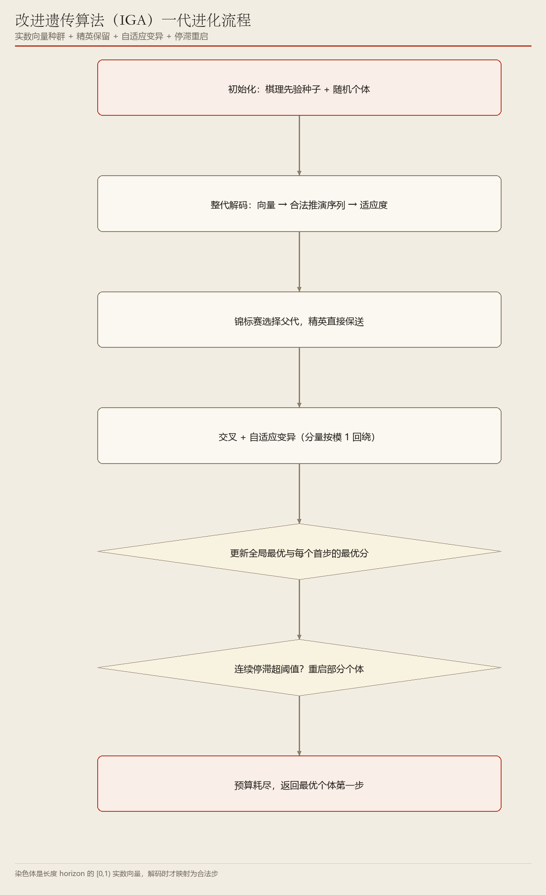
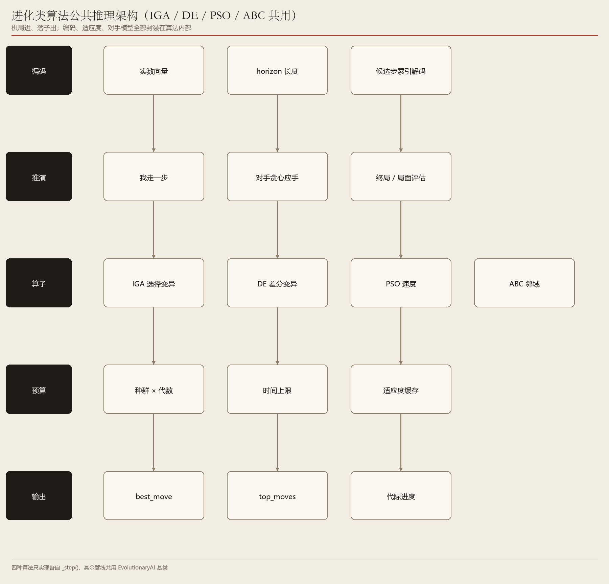

# 04　IGA 与「进化类四兄弟」的公共底座

> 把一串走法当成个体，让好的繁殖、差的淘汰

**编号 04　|　难度：进阶　|　建议阅读：16 分钟　|　前置：第 00 篇；第 03 篇有助于理解「合法步集合」**

[← 返回文档导航](README.md)　|　上一篇：[03 随机基线](03_Random_随机基线.md)　|　下一篇：[05 差分进化 DE](05_DE_差分进化算法.md)

> **30 秒速览：** IGA / DE / PSO / ABC 四种算法共用同一套骨架：用一个实数向量表示「接下来几步怎么走」，把向量解码成一串合法落子，推演完给局面打分（适应度），再让一批向量互相竞争、逐代改进。这一篇先把公共底座讲透，后面 05—07 只讲各自的「怎么改进」。

## 这一篇的目录

1. [1. 这一篇讲什么](#1-这一篇讲什么)
2. [2. 先用直觉理解](#2-先用直觉理解)
3. [3. 跟着走一遍：一个向量怎么变成一步棋](#3-跟着走一遍一个向量怎么变成一步棋)
4. [4. 名词速查](#4-名词速查)
5. [5. 原理、流程图与伪代码](#5-原理流程图与伪代码)
6. [6. 代码在哪儿](#6-代码在哪儿)
7. [7. 动手试一试](#7-动手试一试)
8. [8. 常见疑问与已知限制](#8-常见疑问与已知限制)

---

## 1. 这一篇讲什么

一句话：进化类 AI 不一步步推演博弈树，而是养一大批「候选走法序列」，用打分和迭代把它们越改越好。

读完你应该能回答：

- 一个实数向量，怎么就变成了一串合法的棋步？
- 「适应度」到底在给什么打分，对手被怎么简化处理了？
- IGA 比普通遗传算法「改进」在哪，以及四种算法到底共享了什么？

> **初学者提示：** 这一篇是 04—07 四篇里最重要的一篇。把第 2、3 节的「向量 → 合法步 → 打分」链条弄懂，后面三篇就只是在换「怎么产生下一代」而已。

## 2. 先用直觉理解

假设你要规划一条「接下来 6 步的下法」，但不可能穷举所有组合。于是你先随手写出 50 张纸条，每张写一套下法；把每张纸条在棋盘上摆一遍，看最后局面好不好，给个分；然后留下分数高的纸条，参考它们改写分数低的，再摆一遍……重复几百轮，最后挑最好的那张纸条的第一步来下。

这就是全部。四种进化算法的区别只在「怎么改写纸条」：IGA 用交叉变异，DE 用个体间的差分，PSO 让大家向历史最优靠拢，ABC 用蜜蜂分工做邻域搜索。

> **初学者提示：** 关键巧思：纸条上写的不是具体坐标，而是一串 0~1 的小数。解码时才按「当前局面的合法步清单」换算成坐标，所以无论怎么改小数，都不会产生非法着法。

## 3. 跟着走一遍：一个向量怎么变成一步棋

设 EVO_HORIZON = 6（推演 6 步），某个个体向量是 [0.12, 0.73, 0.40, 0.05, 0.88, 0.31]。当前局面规则层给出 8 个合法候选步，编号 0~7。

1. 取第 1 个分量 0.12：0.12 × 8 = 0.96，取整得索引 0 → 走候选步 [0]。
2. 在棋盘上落下这步，然后让「对手模型」应一手：在启发式排序的前 12 个候选里挑分最高的一手（一层贪心近似）。
3. 局面更新，重新生成合法候选清单（数量可能变了，比如变成 6 个）。
4. 取第 2 个分量 0.73：0.73 × 6 = 4.38，取整得索引 4 → 走新的候选步 [4]。
5. 如此重复 6 轮，得到末局面；若中途分出胜负，用 WIN_SCORE − 步数（赢得越快分越高）给分，否则用评估函数给局面打分。
6. 这个分数就是该个体的适应度；50 个个体都算一遍，就是「一代」。
7. 按算法各自的算子产生下一代，重复到 500 代或 20 秒预算用完。
8. 最后取全局最优个体，把它解码出来的第一步作为正式落子。

第 3 步是初学者最容易误解的地方：向量的每个分量对应的是「那一刻」的候选清单，不是固定不变的棋盘坐标。所以同一个 0.73 在不同局面下会是不同的一步。

## 4. 名词速查

| 名词 | 大白话 | 在项目里的取值 / 位置 |
| --- | --- | --- |
| 个体 / 染色体 | 一张写着「接下来怎么下」的纸条 | 长度 EVO_HORIZON 的 [0,1) 实数向量 |
| 种群 | 一批纸条 | EVO_POPULATION = 50 |
| 解码 decode() | 把小数按当前合法步清单换算成落子 | ai/evolution/kernel.py |
| 适应度 | 推演完末局面的分数 | 胜负分 ±1 000 000 或评估分 |
| 对手模型 | 简化版的「对手会怎么应」 | 前 OPPONENT_TOP = 12 个候选里取贪心最优 |
| 先验种子 | 开局就把明显的好点塞进种群 | prior_vectors()，最多 SEED_TOP = 8 个 |
| 精英保留 | 最好的个体直接进下一代，不许被改坏 | EVO_ELITE = 2 |
| 停滞重启 | 连续多代没进步就随机换掉一批 | EVO_STALL_LIMIT = 6 |
| 预算 | 代数或时间，先到即停 | EVO_GENERATIONS = 500 / EVO_TIME_LIMIT = 20.0 秒 |

## 5. 原理、流程图与伪代码

> **进阶提醒：** 这一节给出四种算法共用的主循环。看不懂算子细节没关系，先记住「解码 → 打分 → 产生下一代」这个三段式。



**图 1　IGA 一代的进化流程：初始化 → 整代评估 → 选择 / 交叉 / 变异 → 停滞判断**（可编辑 Visio 源：[04_iga_flow.vsdx](architecture/04_iga_flow.vsdx)）

合法性怎么保证：连续算子（交叉、变异、速度更新）产生的是任意实数，但解码时每一步都取自「实时合法候选集」，越界分量按模 1 回绕，因此永远不会解码出非法着法。这解决了「连续优化算法用在离散棋步上」最根本的矛盾。

另一道底线是强制预检：一手成五、必挡成五、跳三补点这类确定性战术，在所有搜索之前直接返回，不让种群搜索带偏。



**图 2　进化类算法公共推理架构（IGA / DE / PSO / ABC 共用）**（可编辑 Visio 源：[04_iga_arch.vsdx](architecture/04_iga_arch.vsdx)）

```python
# 四种算法共用的主循环（ai/evolution/base.py）
pop = prior_vectors(board) + random_vectors()   # 先验 + 随机
scores = assess_population(pop)                 # 批量解码 + 打分
for gen in 1..EVO_GENERATIONS:
    pop, scores = step(pop, scores)             # 子类各自的一代算子
    publish(gen)                               # ThinkState 进度回传
    if time_budget_exhausted: break
return best_move
```

IGA 独有的算子：锦标赛选择（k = 3）产生父代，精英个体直接保送；交叉与自适应变异随代数调整幅度；连续 6 代最优分没有改进时触发停滞重启（保留精英、其余随机重置），避免整个种群过早收敛到同一个局部好解。

整代评估由 _assess_population 一次性解码所有个体，末局面交给 ai/accel 的 numpy 批量后端打分；相同个体有适应度缓存，避免重复推演。

## 6. 代码在哪儿

| 文件 | 关键位置 | 作用 |
| --- | --- | --- |
| ai/evolution/base.py | class EvolutionaryAI、select_move() | 公共主循环、预算、进度回传 |
| ai/evolution/base.py | _assess_population() | 整代解码与适应度评估 |
| ai/evolution/kernel.py | decode() / forced_move() / WIN_SCORE | 向量解码、对手模型、胜负分 |
| ai/evolution/optimizers.py | class ImprovedGeneticAI、_step() | IGA 专属算子 |
| ai/accel/batch.py | 批量局面打分 | numpy 后端，减少 Python 循环开销 |
| config/settings.py | EVO_* 系列 | 种群 50 / 代数 500 / 视野 6 / 20 秒 |
| tests/evolution_ai_test.py | 进化类回归测试 | 覆盖四种算法的合法步与收敛 |

## 7. 动手试一试

```python
# IGA 对随机基线：确认「进化确实比瞎下强」
python start.py --game gomoku --mode ai_vs_ai --p1-ai iga --p2-ai random --seed 42

# 把预算收紧到 20 代 / 2 秒，观察棋力明显下降
python start.py --game gomoku --mode ai_vs_ai --p1-ai iga --p2-ai random --evo-generations 20 --evo-time 2 --seed 42

# 四种进化算法横向 PK（它们共用同一套预算）
python start.py --game othello --mode ai_vs_ai --p1-ai iga --p2-ai de --evo-time 5 --seed 42
```

| 参数 | 默认值 | 调大之后会看到什么 |
| --- | --- | --- |
| --evo-population | 50 | 种群更丰富、不易早熟，但每代更慢 |
| --evo-generations | 500 | 迭代更多轮，通常与 --evo-time 同时起作用 |
| --evo-horizon | 6 | 推演看得更远，但向量维度变大、搜索更难 |
| --evo-time | 20.0 秒 | 与代数构成双预算，先到即停 |

> **初学者提示：** 参数默认值请以 config/settings.py 为准。四种进化算法共用同一组 EVO_* 预算，所以横向 PK 是公平的。

## 8. 常见疑问与已知限制

**问：为什么不直接对棋盘坐标做交叉变异？**

答：两个合法坐标交叉后很可能是非法位置。改用「候选清单索引」解码，连续算子就能原样复用，且天然满足合法性。

**问：对手模型只有一层贪心，会不会太天真？**

答：会。它假设对手总下启发式分最高的一手，不代表对手的最优应对，这正是进化类算法棋力不如树搜索的主要原因之一。

**问：这四种算法为什么棋力偏弱？**

答：它们是无模型采样，没有完备的「我最优 / 你最优」对抗推演。在本项目里定位是算法 PK 横向对照与教学演示，不是主力棋力。

- 已知限制：适应度中的对手模型只有一层贪心近似。
- 已知限制：战术底线依赖公共强制预检，种群本身不保证抓住必胜点。
- 提示：连续参数离线寻优（例如调优评估函数权重）才是这类算法真正擅长的场景，见第 05 篇。

---

*ACBP 棋类综合对战平台 · 算法学习文档 · 第 04 篇 / 共 10 篇*
