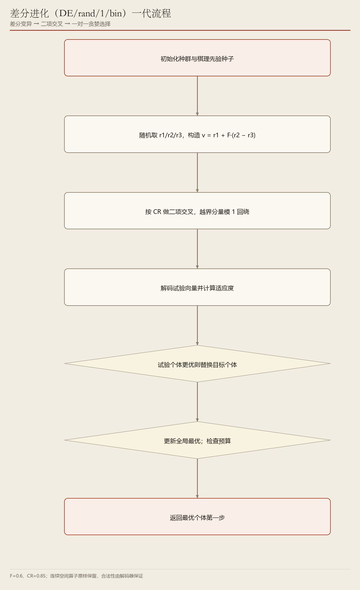
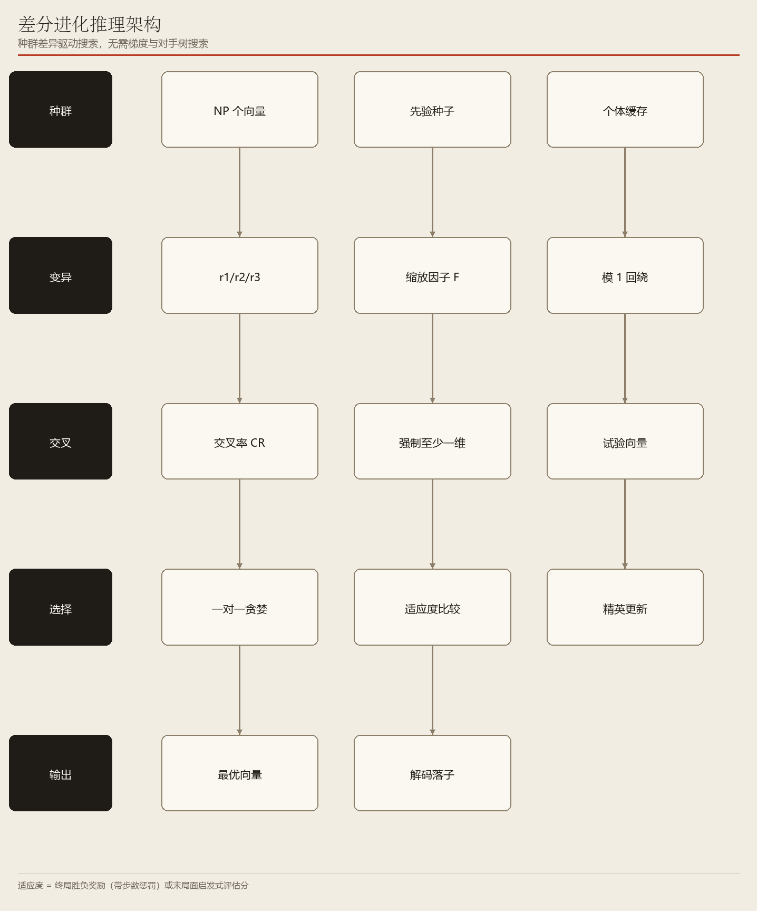

# 05　DE：用「个体之间的差异」当方向

> 差分变异 + 二项交叉 + 一对一贪婪选择

**编号 05　|　难度：进阶　|　建议阅读：12 分钟　|　前置：第 04 篇（进化类公共底座）**

[← 返回文档导航](README.md)　|　上一篇：[04 改进遗传算法 IGA](04_IGA_改进遗传算法.md)　|　下一篇：[06 粒子群 PSO](06_PSO_粒子群优化.md)

> **30 秒速览：** DE 不靠「随机乱改」产生新候选，而是拿种群里另外三个个体的差距当步长，往这个方向试一步；新候选只有比原来的更好才被留下。公式简单、参数只有两个，是连续参数寻优里最稳的一类。

## 这一篇的目录

1. [1. 这一篇讲什么](#1-这一篇讲什么)
2. [2. 先用直觉理解](#2-先用直觉理解)
3. [3. 跟着走一遍：一个目标个体的一代](#3-跟着走一遍一个目标个体的一代)
4. [4. 名词速查](#4-名词速查)
5. [5. 原理、流程图与伪代码](#5-原理流程图与伪代码)
6. [6. 代码在哪儿](#6-代码在哪儿)
7. [7. 动手试一试](#7-动手试一试)
8. [8. 常见疑问与已知限制](#8-常见疑问与已知限制)

---

## 1. 这一篇讲什么

一句话：DE 用「别人之间的差」来决定「我该往哪挪」，并且让新旧个体一对一比拼，赢的留下。

读完你应该能回答：

- v = r1 + F·(r2 − r3) 这一行到底在算什么？
- 为什么「一对一贪婪选择」天然就保住了精英？
- 连续空间里的「差分方向」用在棋步上，为什么仍然有效果？

> **初学者提示：** 第 04 篇讲的向量编码、解码、适应度、对手模型，本篇全部原样复用；这里只讲「下一代怎么来」。

## 2. 先用直觉理解

想象一群人在山上找最高点，彼此看得见对方位置。DE 的做法是：随便找三个人，看其中两人相距多远、朝哪个方向，再让第三个人朝这个方向迈一小步试试；如果新位置更高就搬过去，否则留在原地。

这里「两人之间的差」既是方向也是自适应步长：种群分散时步子自然大（多探索），大家收敛到一块时步子自然小（细调）。所以 DE 不需要像遗传算法那样另写一套变异幅度衰减规则。

> **初学者提示：** F 就是「这一小步」的缩放系数，本项目取 0.6；CR 是「新位置里有多少成分来自这次试探」，取 0.85。

## 3. 跟着走一遍：一个目标个体的一代

设种群里有 50 个向量，现在轮到目标个体 x（长度 6）。

1. 从种群里随机挑出与 x 不同、且彼此不同的三个个体 r1、r2、r3。
2. 算差分向量：r2 − r3 是「这两个人之间的距离和方向」。
3. 构造变异向量 v = r1 + 0.6 × (r2 − r3)。
4. 二项交叉：逐维抛硬币，约 85% 的维度取 v 的值、其余保留 x 的值；并保证至少有一维来自 v（否则这一代等于没变）。
5. 越界分量按模 1 回绕到 [0,1)，保证仍可解码成合法步。
6. 把试验向量解码、推演、打分，与 x 的分数一对一比较。
7. 试验向量更优就替换 x，否则 x 原封不动进入下一代。

第 7 步意味着种群质量单调不降：最优秀的个体永远不会被一次失败的试探挤掉，所以 DE 不需要额外的「精英保留」代码。

## 4. 名词速查

| 名词 | 大白话 | 在项目里的取值 / 位置 |
| --- | --- | --- |
| 差分变异 | 拿另外两人的差距当步长挪一步 | v = r1 + F·(r2 − r3) |
| 缩放因子 F | 这一步迈多大 | EVO_DE_F = 0.6 |
| 二项交叉 CR | 新向量里有多少成分来自试探 | EVO_DE_CR = 0.85 |
| 试验向量 trial | 拼出来的新候选 | 越界按模 1 回绕 |
| 一对一贪婪选择 | 只和自己的原版本比，赢者留下 | ai/evolution/optimizers.py |
| 模 1 回绕 | 超过 1 就减掉整数部分，保证落在 [0,1) | 解码合法性的保障 |
| DE/rand/1/bin | 随机选基 / 1 个差分 / 二项交叉的命名 | 本平台采用的变体 |

## 5. 原理、流程图与伪代码

> **进阶提醒：** 这一节含公式。若已读懂第 3 节的七个步骤，可直接跳到第 7 节调参。



**图 1　DE 一代流程：选三个体 → 差分变异 → 二项交叉 → 贪婪替换**（可编辑 Visio 源：[05_de_flow.vsdx](architecture/05_de_flow.vsdx)）

v = r1 + F·(r2 − r3) 里的三项各有分工：r1 是基准点，(r2 − r3) 提供由种群自身分布决定的方向与尺度，F 控制信任这个方向多少。F 太大容易跳过好区域，太小则收敛慢。

CR 控制「这一代改多少维」：CR 高，多个维度同时变，探索更激进；CR 低，一次只动少数维度，更接近局部细调。



**图 2　DE 推理架构：编码、变异、交叉、选择、输出**（可编辑 Visio 源：[05_de_arch.vsdx](architecture/05_de_arch.vsdx)）

```python
for target in population:
    r1, r2, r3 = sample_others(population, 3)
    mutant = r1 + F * (r2 - r3)
    trial  = binomial_crossover(target, mutant, CR)
    trial  = wrap_modulo_one(trial)
    if fitness(trial) >= fitness(target):
        replace(target, trial)
```

关于「几何意义」的诚实说明：向量的每个分量只决定「在当前候选步清单里选第几个」，而清单每推演一步都会重新生成。因此差分方向在离散棋步空间里并没有真正的几何含义，它退化成对「推演序列」的扰动。它依然能探索不同首步及其后续组合，但棋力上限明显低于树搜索——这类算法真正的主场是连续参数离线寻优。

## 6. 代码在哪儿

| 文件 | 关键位置 | 作用 |
| --- | --- | --- |
| ai/evolution/optimizers.py | class DifferentialEvolutionAI、_step() | 一代的变异 / 交叉 / 选择 |
| ai/evolution/base.py | class EvolutionaryAI | 公共主循环与预算 |
| ai/evolution/kernel.py | decode() | 向量 → 合法推演序列 |
| config/settings.py | EVO_DE_F / EVO_DE_CR | 默认 0.6 / 0.85 |
| tests/evolution_ai_test.py | DE 回归用例 | 合法步与收敛性 |

## 7. 动手试一试

```python
# DE 对随机基线
python start.py --game gomoku --mode ai_vs_ai --p1-ai de --p2-ai random --seed 42

# 与 IGA 横向对比（共用同一组 EVO_* 预算）
python start.py --game othello --mode ai_vs_ai --p1-ai de --p2-ai iga --evo-time 5 --seed 42

# 种群调小，观察多样性下降后的表现
python start.py --game gomoku --mode ai_vs_ai --p1-ai de --p2-ai random --evo-population 8 --seed 42
```

| 参数 | 默认值 | 怎么调 / 会看到什么 |
| --- | --- | --- |
| EVO_DE_F（源码） | 0.6 | 调大步子更大、更跳；常用范围 0.4~0.9 |
| EVO_DE_CR（源码） | 0.85 | 调低则每次只改少数维度，收敛更保守 |
| --evo-population | 50 | 建议至少 4 倍于向量维度（horizon = 6） |
| --evo-time | 20.0 秒 | 与 500 代构成双预算，先到即停 |

> **初学者提示：** F 与 CR 是源码常量，不在命令行里；想试不同取值请改 config/settings.py 后重新运行。

## 8. 常见疑问与已知限制

**问：为什么一定要三个互不相同的个体？**

答：若 r1、r2、r3 有重复，差分向量会退化甚至为 0，变异失去探索能力；种群太小（小于 4）时这点尤其明显。

**问：DE 为什么不需要精英保留？**

答：因为每个试验向量只和它对应的原个体竞争，只要不更差就不替换，当前最优个体不可能被一次随机试探挤掉。

**问：它适合拿来下棋吗？**

答：不是最合适的。棋步是离散且强对抗的，DE 的差分方向缺乏几何意义。本项目把它作为算法 PK 的横向对照；它更适合给评估函数调权重。

- 已知限制：差分方向在离散着法空间没有严格几何意义。
- 已知限制：对手模型只有一层贪心，棋力定位为对照基线。
- 适合场景：连续参数离线寻优（如评估函数权重）时收敛最快、最推荐。

---

*ACBP 棋类综合对战平台 · 算法学习文档 · 第 05 篇 / 共 10 篇*
