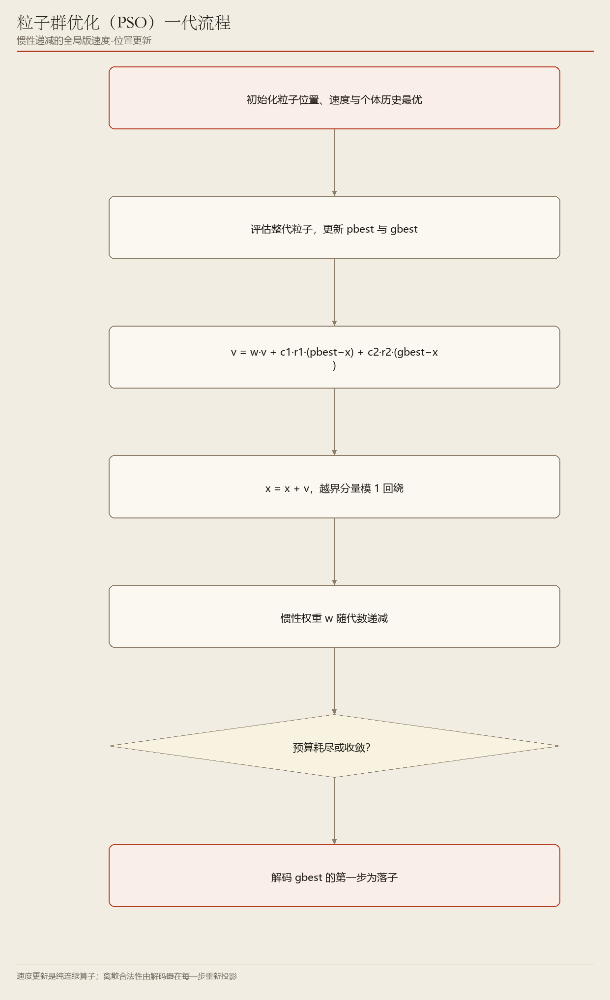
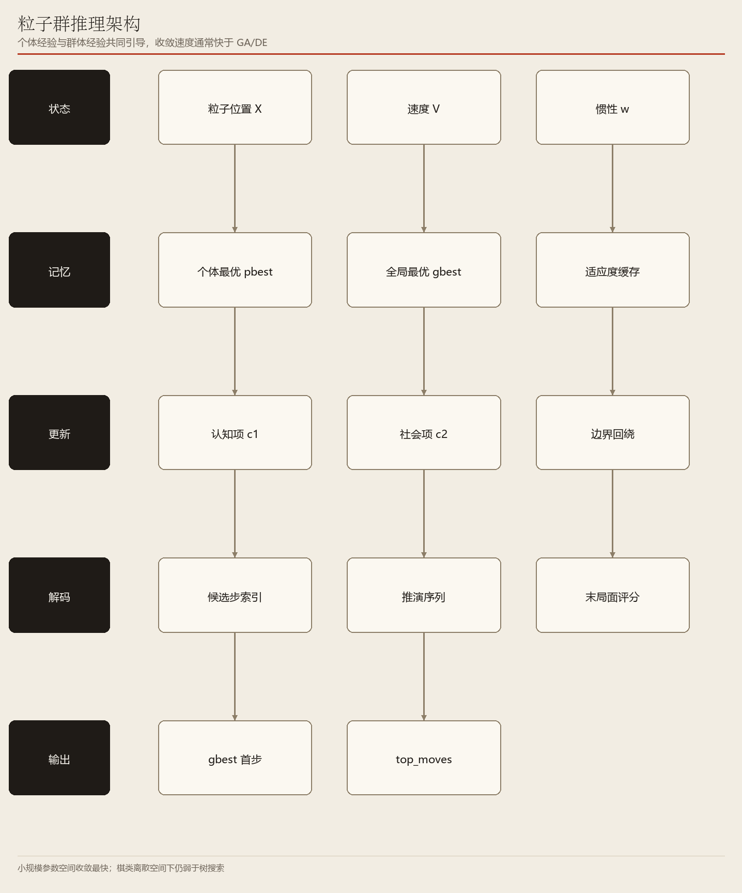

# 06　PSO：一群粒子一起向「历史最好」靠

> 自己的经验 + 全群的经验，共同决定下一步往哪飞

**编号 06　|　难度：进阶　|　建议阅读：12 分钟　|　前置：第 04 篇（进化类公共底座）**

[← 返回文档导航](README.md)　|　上一篇：[05 差分进化 DE](05_DE_差分进化算法.md)　|　下一篇：[07 人工蜂群 ABC](07_ABC_人工蜂群.md)

> **30 秒速览：** 每个粒子都记得「自己这辈子到过的最好位置」，也知道「全群目前的最好位置」。每一代，它带着惯性、被这两个位置同时拉一把，于是早期满场探索、后期集中收敛。

## 这一篇的目录

1. [1. 这一篇讲什么](#1-这一篇讲什么)
2. [2. 先用直觉理解](#2-先用直觉理解)
3. [3. 跟着走一遍：一个粒子的一代](#3-跟着走一遍一个粒子的一代)
4. [4. 名词速查](#4-名词速查)
5. [5. 原理、流程图与伪代码](#5-原理流程图与伪代码)
6. [6. 代码在哪儿](#6-代码在哪儿)
7. [7. 动手试一试](#7-动手试一试)
8. [8. 常见疑问与已知限制](#8-常见疑问与已知限制)

---

## 1. 这一篇讲什么

一句话：PSO 让一群候选解像鸟群一样飞行，靠「个体经验 + 群体经验」而不是交叉变异来改进。

读完你应该能回答：

- 速度 v 在这个算法里到底代表什么，为什么要保留上一代的速度？
- pbest 和 gbest 分别是什么，谁负责更新？
- 为什么每次重新选步时，这些跨代状态都要清空？

## 2. 先用直觉理解

鸟群找食物时，每只鸟不知道食物在哪，但知道两件事：「我自己飞过的最香的位置」和「大家目前发现的最香的位置」。于是它一边保持原来的飞行惯性，一边朝这两个方向各偏一点。

惯性权重 w 随代数递减：早期 w 大，飞得野、覆盖面广；后期 w 小，大家慢慢收拢到最有希望的区域细找。这就是「惯性递减全局版 PSO」。

> **初学者提示：** 和 DE 一样，粒子位置仍是长度 6 的 [0,1) 实数向量，解码成棋步的整套机制完全沿用第 04 篇。

## 3. 跟着走一遍：一个粒子的一代

设粒子 i 当前位置 x、上代速度 v，它自己的历史最优 pbest，全群历史最优 gbest。

1. 算新速度：v = w·v + c1·r1·(pbest − x) + c2·r2·(gbest − x)。三项依次是：保持惯性、向自己的最好位置靠、向全群最好位置靠。
2. r1、r2 是每次都重新抽的随机数，让同样的两点之间也能飞出不同路线。
3. 更新位置：x = x + v，越界分量按模 1 回绕。
4. 把新 x 解码成推演序列、打分，得到本次适应度。
5. 若比自己的历史最好分更高，更新 pbest；若比全群最好分更高，更新 gbest。
6. 一代结束后把惯性 w 按衰减系数调小一点，进入下一代。
7. 预算用完时，输出 gbest 解码出来的第一步。

和 DE 的关键差别：DE 的下一代来自「别人之间的差」，PSO 的下一代来自「自己 + 全群的记忆」，因此 PSO 多了 _velocity、_pbest、_pbest_scores 这些跨代状态。

## 4. 名词速查

| 名词 | 大白话 | 在项目里的取值 / 位置 |
| --- | --- | --- |
| 粒子 particle | 一个候选解（= 一个向量） | EVO_POPULATION = 50 |
| 速度 v | 这一代打算往哪个方向、挪多大 | _velocity，跨代保留 |
| 惯性 w | 保留多少上代速度，随代数递减 | 早期探索、后期收敛 |
| pbest | 这个粒子自己见过的最好位置 | _pbest / _pbest_scores |
| gbest | 全群目前的最好位置 | select_move() 内维护 |
| c1 / c2 | 信自己 / 信大家的权重 | 认知系数 / 社会系数 |
| 模 1 回绕 | 位置越界后折回 [0,1) | 速度本身保留，不回绕 |

## 5. 原理、流程图与伪代码



**图 1　PSO 一代流程：更新速度 → 更新位置 → 打分 → 更新 pbest / gbest → 衰减 w**（可编辑 Visio 源：[06_pso_flow.vsdx](architecture/06_pso_flow.vsdx)）

更新公式：v = w·v + c1·r1·(pbest − x) + c2·r2·(gbest − x)，x = x + v。若 c1 远大于 c2，粒子各走各的、探索强但收敛慢；反过来则全群很快挤到同一个点，容易早熟。

边界处理：位置越界按模 1 回绕，速度保留。由于解码时每个分量都会重新投影到当前合法候选集，「速度」在离散着法空间没有直接的几何意义，但作为对推演序列的连续扰动仍然有效。



**图 2　PSO 推理架构：速度 / 位置 / 个体经验 / 群体经验 / 输出**（可编辑 Visio 源：[06_pso_arch.vsdx](architecture/06_pso_arch.vsdx)）

```python
for each particle i:
    v[i] = w*v[i] + c1*r1*(pbest[i]-x[i]) + c2*r2*(gbest-x[i])
    x[i] = wrap(x[i] + v[i])
    score = fitness(decode(x[i]))
    if score > pbest_score[i]: pbest[i] = x[i]
    if score > gbest_score:    gbest    = x[i]
w *= decay
```

跨代状态的生命周期：_velocity、_pbest、_pbest_scores 由 EvolutionaryAI 基类维护，在每次 select_move() 开始时随 _reset_search() 清空。原因是不同棋局的合法步清单完全不同，上一局的速度和最优向量在这一局没有任何意义，沿用只会把搜索带偏。

## 6. 代码在哪儿

| 文件 | 关键位置 | 作用 |
| --- | --- | --- |
| ai/evolution/optimizers.py | class ParticleSwarmAI、_step() | 速度 / 位置更新与最优维护 |
| ai/evolution/base.py | _reset_search() | 每次选步前清空跨代状态 |
| ai/evolution/base.py | _velocity / _pbest / _pbest_scores | PSO 专属的跨代记忆 |
| ai/evolution/kernel.py | decode() | 向量解码为合法推演序列 |
| config/settings.py | EVO_* 系列 | 粒子数 50 / 代数 500 / 20 秒 |

## 7. 动手试一试

```python
# PSO 对随机基线
python start.py --game gomoku --mode ai_vs_ai --p1-ai pso --p2-ai random --seed 42

# 四种进化算法两两 PK，感受收敛风格差异
python start.py --game chess --mode ai_vs_ai --p1-ai pso --p2-ai abc --evo-time 5 --seed 42

# 缩小种群，观察「全群过早收拢」
python start.py --game gomoku --mode ai_vs_ai --p1-ai pso --p2-ai random --evo-population 6 --seed 42
```

| 参数 | 默认值 | 调大之后会看到什么 |
| --- | --- | --- |
| --evo-population | 50 | 粒子更多、多样性更好，每代更慢 |
| --evo-generations | 500 | 迭代更多轮，惯性 w 也衰减得更多 |
| --evo-horizon | 6 | 维度更高，收敛明显变难 |
| --evo-time | 20.0 秒 | 与代数构成双预算，先到即停 |

> **初学者提示：** c1 / c2 与 w 的衰减系数写在 ai/evolution/optimizers.py 里，想直观感受「探索 vs 收敛」，改这两个系数比改预算更明显。

## 8. 常见疑问与已知限制

**问：为什么 PSO 通常比 GA / DE 收敛快？**

答：因为所有粒子都被 gbest 直接牵引，信息是全群共享的；代价是也更容易一起陷入同一个局部最优。

**问：速度越界要处理吗？**

答：项目只对位置做模 1 回绕，速度保留。位置始终可解码，因此不会产生非法着法。

**问：GPU 能把 PSO 加速很多吗？**

答：只能加速批量局面打分。推演过程是串行、不规则的树形分支，GPU 帮不上这部分。

- 已知限制：离散棋步空间里「速度」缺乏严格几何意义。
- 已知限制：对手模型只有一层贪心，棋力定位为对照基线。
- 适合场景：小规模连续参数寻优（评估函数权重）收敛最快；本项目四种群体算法里，PSO 在象棋 2 秒预算下吞吐提升最明显。

---

*ACBP 棋类综合对战平台 · 算法学习文档 · 第 06 篇 / 共 10 篇*
