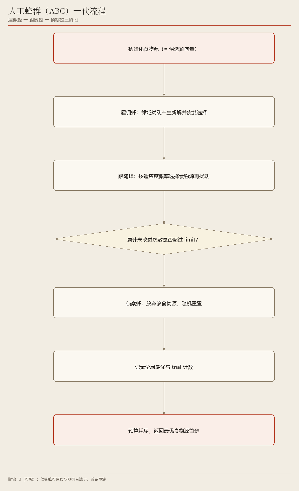
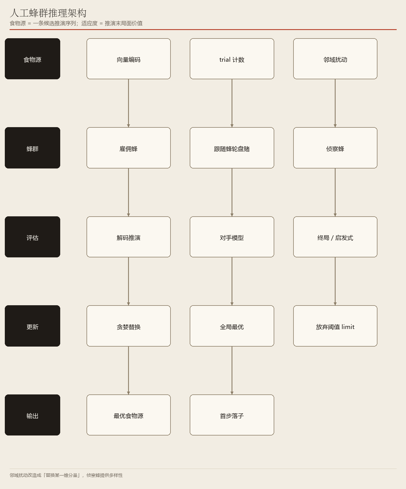

# 07　ABC：把候选解当成一片片花圃

> 雇佣蜂就近找、跟随蜂挑甜的、侦察蜂放弃久无收获的

**编号 07　|　难度：进阶　|　建议阅读：12 分钟　|　前置：第 04 篇（进化类公共底座）**

[← 返回文档导航](README.md)　|　上一篇：[06 粒子群 PSO](06_PSO_粒子群优化.md)　|　下一篇：[08 Edax 外部引擎](08_Edax_黑白棋专用引擎.md)

> **30 秒速览：** ABC 用三种角色分工：雇佣蜂守着一片花圃（候选解）在附近试新位置，跟随蜂按花蜜多少决定去帮谁的忙，侦察蜂把长期没有收成的花圃直接换掉。探索与开采靠这套分工自然平衡。

## 这一篇的目录

1. [1. 这一篇讲什么](#1-这一篇讲什么)
2. [2. 先用直觉理解](#2-先用直觉理解)
3. [3. 跟着走一遍：一代里的三个角色](#3-跟着走一遍一代里的三个角色)
4. [4. 名词速查](#4-名词速查)
5. [5. 原理、流程图与伪代码](#5-原理流程图与伪代码)
6. [6. 代码在哪儿](#6-代码在哪儿)
7. [7. 动手试一试](#7-动手试一试)
8. [8. 常见疑问与已知限制](#8-常见疑问与已知限制)

---

## 1. 这一篇讲什么

一句话：ABC 是「有分工的邻域搜索」，好解被反复开采、差解被定期重置。

读完你应该能回答：

- 三种蜂各自做什么，为什么需要三种？
- trial 计数是什么，达到阈值后为什么必须整片换掉？
- 「邻域扰动」在棋步向量上具体改了什么？

## 2. 先用直觉理解

把每个候选解想成一片花圃。雇佣蜂一人守一片，只在自家附近换个角度试试有没有更甜的花；跟随蜂不固定守哪片，而是看哪片花蜜多就多派几只去帮着找；侦察蜂专门处理「连续好多天一点没长进」的花圃——与其继续耗着，不如整片翻掉重新播随机种子。

于是好解被集中开采（ exploitation ），长期没希望的解被强制换掉（ exploration ），这两件事由不同角色负责，互不干扰。

> **初学者提示：** 和 PSO 的区别：PSO 靠「向全群最优靠拢」收敛，ABC 靠「按适应度比例分配搜索次数」收敛，并且有明确的「放弃机制」来保住多样性。

## 3. 跟着走一遍：一代里的三个角色

设共有 50 片花圃（食物源），每片是一个长度 6 的向量。

1. 雇佣蜂阶段：对每片花圃做一次邻域扰动——随机挑一维，参照另一片花圃改写它的值，得到一个新候选。
2. 贪婪选择：新候选只有在分数更高时才替换原花圃；否则该花圃的 trial（连续未改进次数）加 1。
3. 跟随蜂阶段：按适应度做轮盘赌，分数越高的花圃被选中次数越多；每选中一次就再做一次邻域扰动 + 贪婪选择。
4. 侦察蜂阶段：检查所有 trial，若某片连续 5 代没有改进，直接用一个全新随机向量替换它，trial 归零。
5. 同步更新全局最优，并把代数 / 最优分写进 ThinkState 供界面显示。
6. 预算用完（500 代或 20 秒）时，返回全局最优个体的第一步。

「邻域扰动」在本项目里的具体含义是：替换或修改向量中的某一维分量，等价于改变推演序列里的某一步选择；侦察蜂则可以直接取随机合法步对应的编码。

## 4. 名词速查

| 名词 | 大白话 | 在项目里的取值 / 位置 |
| --- | --- | --- |
| 食物源 | 一个候选解（= 一个向量） | 数量 = EVO_POPULATION = 50 |
| 雇佣蜂 | 一蜂守一片，在附近试新解 | 每片花圃各一次扰动 |
| 跟随蜂 | 按花蜜多少挑花圃帮忙 | 轮盘赌，适应度比例选择 |
| 侦察蜂 | 放弃久无改进的花圃，随机重置 | trial > EVO_ABC_LIMIT = 5 |
| trial | 连续多少代没进步 | 改进即归零 |
| 轮盘赌 | 越好的解被选中概率越高 | 按适应度比例分配 |
| 贪婪选择 | 只有更优才替换 | 保证种群质量单调不降 |

## 5. 原理、流程图与伪代码



**图 1　ABC 一代流程：雇佣蜂 → 跟随蜂 → 侦察蜂**（可编辑 Visio 源：[07_abc_flow.vsdx](architecture/07_abc_flow.vsdx)）

trial 计数是 ABC 最有辨识度的机制：它给每个解单独记「已经多久没进步」，因此不需要全局判断「是不是收敛了」，哪个解停滞就重置哪个，粒度更细、更不容易误伤还在爬坡的解。

跟随蜂用轮盘赌按适应度比例分配搜索次数，优质花圃在一代里可能被扰动多次，等效于把计算预算押在更有希望的区域。



**图 2　ABC 推理架构：食物源、三种蜂、贪婪选择与输出**（可编辑 Visio 源：[07_abc_arch.vsdx](architecture/07_abc_arch.vsdx)）

```python
# 雇佣蜂
for source in sources:
    cand = perturb_neighborhood(source)
    greedy_replace(source, cand)
# 跟随蜂
for _ in range(n_onlookers):
    src = roulette_wheel(sources)
    greedy_replace(src, perturb_neighborhood(src))
# 侦察蜂
for src in sources:
    if trial[src] > LIMIT: src = random_vector()
```

因为雇佣蜂与跟随蜂都采用「只有更优才替换」的贪婪选择，种群整体质量单调不降；全局最优同步更新到 ThinkState，界面上能看到代际进度与当前最佳步。

## 6. 代码在哪儿

| 文件 | 关键位置 | 作用 |
| --- | --- | --- |
| ai/evolution/optimizers.py | class ArtificialBeeColonyAI、_step() | 三阶段算子与 trial 计数 |
| ai/evolution/base.py | class EvolutionaryAI | 公共主循环与预算 |
| ai/evolution/kernel.py | decode() | 向量 → 合法推演序列 |
| config/settings.py | EVO_ABC_LIMIT | 默认 5 代未改进即重置 |
| tests/evolution_ai_test.py | ABC 回归用例 | 合法步与收敛性 |

## 7. 动手试一试

```python
# ABC 对随机基线
python start.py --game gomoku --mode ai_vs_ai --p1-ai abc --p2-ai random --seed 42

# 与 PSO 横向对比（一个靠放弃、一个靠牵引）
python start.py --game othello --mode ai_vs_ai --p1-ai abc --p2-ai pso --evo-time 5 --seed 42

# 代数收紧，观察「侦察蜂还没来得及起作用」
python start.py --game gomoku --mode ai_vs_ai --p1-ai abc --p2-ai random --evo-generations 10 --evo-time 2 --seed 42
```

| 参数 | 默认值 | 怎么调 / 会看到什么 |
| --- | --- | --- |
| EVO_ABC_LIMIT（源码） | 5 | 调小更频繁重置（更探索），调大更耐心开采 |
| --evo-population | 50 | 花圃数量，同时也是雇佣蜂数量 |
| --evo-generations | 500 | 代数太少时侦察蜂几乎不触发 |
| --evo-time | 20.0 秒 | 与代数构成双预算，先到即停 |

## 8. 常见疑问与已知限制

**问：ABC 为什么常比 GA / DE 评估次数多？**

答：一代里雇佣蜂和跟随蜂各做一批扰动，优质花圃还会被轮盘赌重复选中，总评估次数自然更高。

**问：把 trial 阈值调大一点会怎样？**

答：解被保留得更久，开采更充分，但更容易困在局部最优；多峰适应度地形（如中残局）下通常反而更需要一个偏小的阈值。

**问：它的棋力比树搜索弱吗？**

答：是的。和另外三种进化算法一样，没有对手最优应对的完备性，定位为算法 PK 对照基线。

- 已知限制：评估次数通常多于 GA / DE，单步耗时略高。
- 已知限制：对手模型只有一层贪心，棋力定位为对照基线。
- 相对优势：侦察蜂带来的多样性在多峰适应度地形（中残局）下更稳。

---

*ACBP 棋类综合对战平台 · 算法学习文档 · 第 07 篇 / 共 10 篇*
