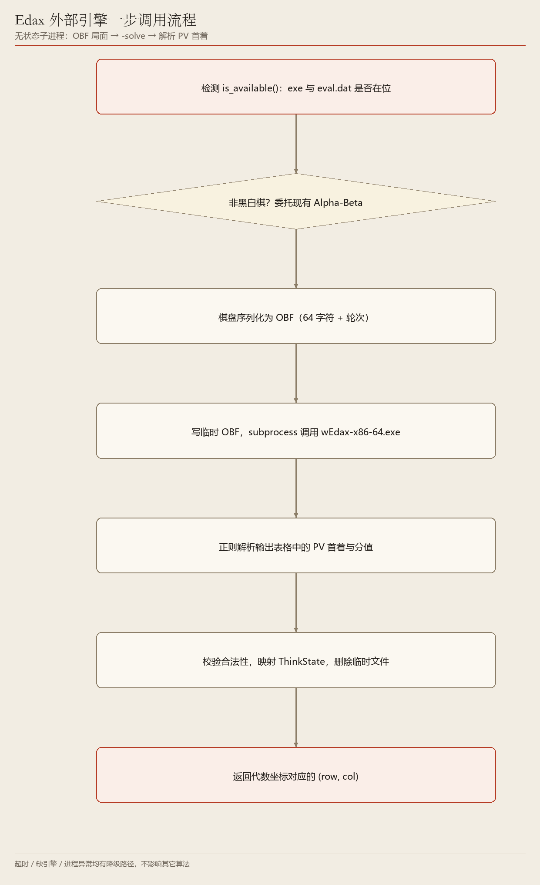
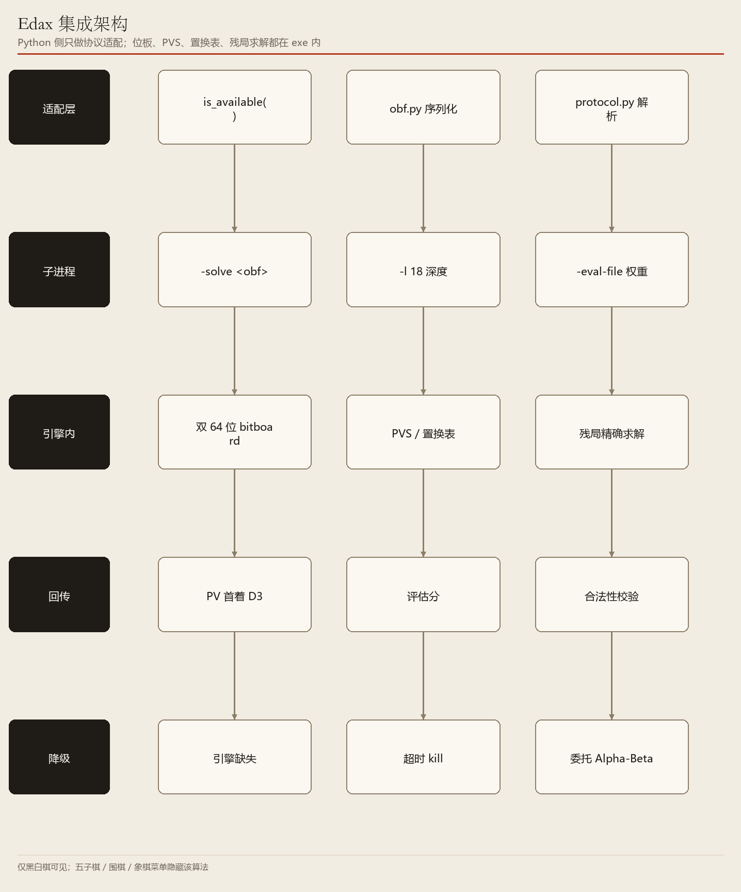

# 08　Edax：请一位职业棋手当外援

> 把局面写成纸条递出去，读回它建议的第一步

**编号 08　|　难度：深入　|　建议阅读：13 分钟　|　前置：第 00 篇；知道黑白棋规则更好**

[← 返回文档导航](README.md)　|　上一篇：[07 人工蜂群 ABC](07_ABC_人工蜂群.md)　|　下一篇：[09 规则层与位板加速](09_规则层与位板加速架构.md)

> **30 秒速览：** Edax 是外部黑白棋专用强引擎，本项目不重写它，只做协议适配：每步把棋盘写成 OBF 临时文件、启动一次子进程、从输出里解析 PV 首着。引擎文件缺失时整个功能自动隐身，不影响其它算法。

## 这一篇的目录

1. [1. 这一篇讲什么](#1-这一篇讲什么)
2. [2. 先用直觉理解](#2-先用直觉理解)
3. [3. 跟着走一遍：一步调用的全过程](#3-跟着走一遍一步调用的全过程)
4. [4. 名词速查](#4-名词速查)
5. [5. 原理、流程图与伪代码](#5-原理流程图与伪代码)
6. [6. 代码在哪儿](#6-代码在哪儿)
7. [7. 动手试一试](#7-动手试一试)
8. [8. 常见疑问与已知限制](#8-常见疑问与已知限制)

---

## 1. 这一篇讲什么

一句话：Edax 不是本项目写的算法，而是「外援」——Python 侧只负责把局面翻译给它、把答案翻译回来。

读完你应该能回答：

- 为什么不把引擎直接改造成 Python 类，而要用子进程？
- OBF 是什么，PV 又是什么？
- 为什么它对其它棋种和其它算法「零影响」？

> **初学者提示：** 本篇偏工程集成，算法细节可以略读。只想跑起来看效果的，直接跳到第 7 节。

## 2. 先用直觉理解

想象你正在下棋，身边坐着一位只懂黑白棋的特级大师。你不会请他重写你的整个比赛流程，只会每次把当前棋局抄在一张纸条上递过去，等他写回一句「我建议下 D3」，再把 D3 翻译成棋盘坐标。

这里「纸条」就是 OBF 文件，「特级大师」是 wEdax-x86-64.exe，「递纸条」是 subprocess 启动一次进程，「D3」是引擎输出里 PV（主要变例）的第一个着法。

> **初学者提示：** 这种「无状态、每步一次调用」的方式，比让引擎长驻并用 NBoard / GTP 协议通信简单得多：没有进程内状态、没有死锁，超时直接结束进程即可。

## 3. 跟着走一遍：一步调用的全过程

假设黑白棋轮到 AI，引擎已放在 vendor/edax/ 下。

1. 把 8×8 棋盘按行优先写成 64 个字符：X 表黑、O 表白、- 表空，再补一个轮次标记（X; 或 O;），得到 OBF 文本。
2. 把 OBF 写进一个临时文件，拼出命令：wEdax-x86-64.exe -solve <obf> -l 18 -eval-file <绝对路径> -book-usage off。
3. 用 subprocess.run 启动进程，设置 timeout（默认 8 秒）与工作目录，捕获标准输出。
4. 从输出表格里用正则取出 PV 行的第一个着法，例如 D3。
5. 把代数坐标换算成 (row, col)：D3 → (2, 3)。
6. 删除临时文件，把这一步作为 select_move() 的返回值交给对局层。

整个过程对对局层完全透明：它只知道「有个 AI 返回了 (2,3)」，和 MCTS 返回坐标没有任何区别。

## 4. 名词速查

| 名词 | 大白话 | 在项目里的取值 / 位置 |
| --- | --- | --- |
| Edax 4.6 | 开源黑白棋强引擎（外部程序） | vendor/edax/ |
| OBF | 描述局面的纯文本格式 | ai/othello_ext/obf.py 负责双向换算 |
| PV | 引擎认为双方最优的一条主线，首着即建议 | 从输出表格解析 |
| -l 18 | 搜索深度 / 等级 | ACBP_EDAX_LEVEL，默认 18 |
| eval.dat | 引擎的模式评估权重文件 | vendor/edax/data/ |
| bitboard | 用两个 64 位整数表示整张棋盘 | 引擎内部实现 |
| PVS / 置换表 | 主变量搜索与已算局面的缓存 | 引擎内部实现 |
| 零影响设计 | 引擎不在时功能自动隐藏 | is_available() 返回 False |

## 5. 原理、流程图与伪代码

> **进阶提醒：** 这一节涉及子进程与外部协议，属于「要改集成代码时再看」的内容。



**图 1　Edax 一步调用流程：OBF → 子进程 → 解析 PV 首着**（可编辑 Visio 源：[08_edax_flow.vsdx](architecture/08_edax_flow.vsdx)）

选型依据：Edax 4.6 是公开资料里最强的免费开源黑白棋引擎之一，2023 年 8×8 黑白棋弱解（双方完美下为平局）用的正是 Edax 的优化版本。它的强不在单一算法，而在四个专用组件：双 64 位 bitboard、PVS/NegaScout + 迭代加深 + aspiration + Zobrist 置换表、模式化评估（eval.dat 权重）、残局精确求解（空位少时返回精确子数差）。

因此合理做法是「不重写、只适配」：Python 侧只用标准库 subprocess / re / tempfile，不往 requirements.txt 加任何依赖。



**图 2　Edax 集成架构：可用性检测、协议适配、棋种隔离、降级**（可编辑 Visio 源：[08_edax_arch.vsdx](architecture/08_edax_arch.vsdx)）

```python
cmd = [exe, '-solve', obf_path, '-l', str(level),
       '-eval-file', eval_dat, '-book-usage', 'off']
proc = subprocess.run(cmd, cwd=edax_dir, timeout=time_limit,
                      stdin=DEVNULL, stdout=PIPE, stderr=PIPE)
move = parse_pv_first_move(proc.stdout)   # 正则取 PV 首着
```

OBF 格式细节：64 个字符的行优先棋盘，加空格与轮次标记。ai/othello_ext/obf.py 负责「二维棋盘 ↔ OBF ↔ 代数坐标」的双向换算，ai/othello_ext/protocol.py 负责拼命令与解析输出。

零影响设计：引擎缺失时 is_available() 返回 False，菜单里该算法直接不出现；棋种隔离方面，主菜单与回放续局按棋种过滤，命令行强选非黑白棋时 EdaxAI 检测到非 OthelloBoard 会直接委托现有 Alpha-Beta，保证外部引擎一次都不会被调用。

## 6. 代码在哪儿

| 文件 / 变量 | 作用 |
| --- | --- |
| ai/othello_ext/__init__.py | 环境变量配置与 is_available() 可用性检测 |
| ai/othello_ext/obf.py | 二维棋盘 ↔ OBF ↔ 代数坐标换算 |
| ai/othello_ext/protocol.py | 拼命令、跑子进程、解析 PV 首着 |
| ai/othello_ext/edax_ai.py | class EdaxAI，实现统一 select_move() 与降级 |
| ai/factory.py | 'edax' 分支 | 延迟导入，未选中时不加载适配层 |
| vendor/edax/ | 引擎 exe 与 data/eval.dat | 需自行放置，缺失则功能隐藏 |
| tests/othello_edax_test.py | OBF 换算与集成回归 | 覆盖协议与降级路径 |

| 环境变量 | 默认值 | 含义 |
| --- | --- | --- |
| ACBP_EDAX_DIR | vendor/edax | 引擎目录（exe + data/eval.dat） |
| ACBP_EDAX_EXE | wEdax-x86-64.exe | 可执行文件名 |
| ACBP_EDAX_LEVEL | 18 | 传给 -l 的搜索深度，范围 1~60 |
| ACBP_EDAX_TIME | 8.0 | 子进程硬超时秒数，范围 0.5~60 |

## 7. 动手试一试

```python
# 引擎到位后，直接让 Edax 对本项目 Alpha-Beta（黑白棋）
python start.py --game othello --mode ai_vs_ai --p1-ai edax --p2-ai alphabeta --ab-depth 3

# 降低引擎等级，观察棋力与耗时变化（Windows 示例）
set ACBP_EDAX_LEVEL=8
python start.py --game othello --mode ai_vs_ai --p1-ai edax --p2-ai alphabeta --ab-depth 3

# 在五子棋里强选 edax：会自动退回 Alpha-Beta，外部引擎不会被调用
python start.py --game gomoku --mode ai_vs_ai --p1-ai edax --p2-ai random
```

- 若菜单里看不到 Edax，先检查 vendor/edax/ 下是否有 exe 与 data/eval.dat。
- 项目实战记录：Edax 对深度 3 的 Alpha-Beta 各执黑白 10 局，10 胜 0 负、0 非法步。
- 调小 ACBP_EDAX_LEVEL 能明显缩短每步等待，适合先跑通流程。

## 8. 常见疑问与已知限制

**问：为什么不用长驻进程通信，每步都启动一次不慢吗？**

答：确实有 50~200 ms 的权重加载开销，但换来「无状态、无死锁、超时直接 kill」的简单模型。对本项目这种一步一调用的使用方式，可靠性更值钱。

**问：其它棋种能用 Edax 吗？**

答：不能，它是黑白棋专用引擎。强选时会自动委托 Alpha-Beta，保证不会把五子棋 / 象棋局面传给引擎。

**问：引擎文件没放会报错吗？**

答：不会。is_available() 返回 False，菜单里该选项直接隐藏，其它算法的启动路径完全不受影响。

- 已知限制：release 是 Windows 64 位 exe，其它平台需自行编译。
- 已知限制：每步启动外部进程有 50~200 ms 权重加载开销。
- 已知限制：仅支持黑白棋，且依赖外部权重文件 eval.dat。

---

*ACBP 棋类综合对战平台 · 算法学习文档 · 第 08 篇 / 共 10 篇*
