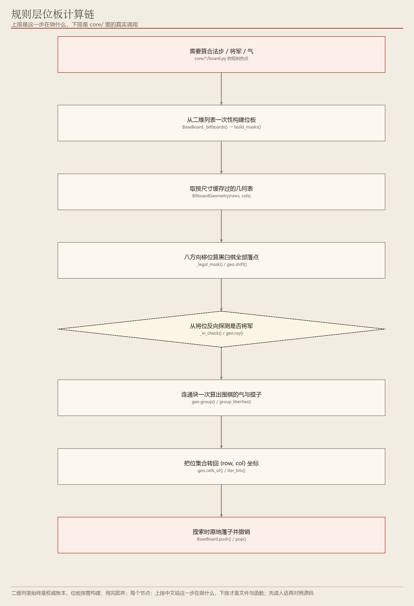
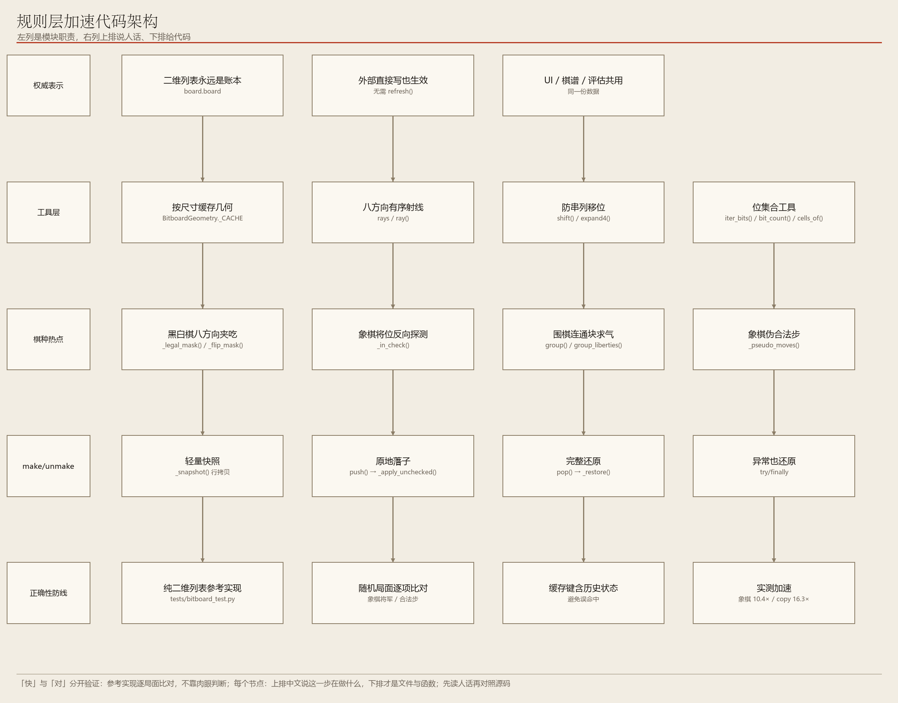

# 09　让「算合法步」快十倍：规则层与位板

> 二维列表为权威表示、位板按需构建；逐行读 `core/bitboard.py` 与 `push/pop`

**编号 09　|　难度：深入　|　建议阅读：30 分钟　|　前置：第 00 篇（分层）、第 02 篇（用 `push/pop` 的搜索）**

[← 返回文档导航](README.md)　|　上一篇：[08 Edax 黑白棋专用引擎](08_Edax_黑白棋专用引擎.md)　|　下一篇：本篇是最后一篇

> **30 秒速览：** AI 每一步都要问几百上千次「这里能不能下」，规则层就是瓶颈。项目把棋盘压成整数位板，用一次位运算算出一整片结果；同时用 `push/pop` 原地推演代替反复复制棋盘。这一篇逐段读 `core/bitboard.py`、`BaseBoard` 的快照与撤销栈、黑白棋 / 象棋 / 围棋的规则热点，以及「怎么证明加速之后没算错」。

> **源码快照说明：** 代码片段基于 **2026-11-10** 源码，均为**节选**；行号仅供对照，**函数名才是稳定定位**。

## 这一篇的目录

1. [1. 这一篇讲什么](#1-这一篇讲什么)
2. [2. 先用直觉理解](#2-先用直觉理解)
3. [3. 跟着代码走一遍](#3-跟着代码走一遍)
4. [4. 名词速查](#4-名词速查)
5. [5. 源码逐段精读](#5-源码逐段精读)
6. [6. 代码模块地图](#6-代码模块地图)
7. [7. 动手试一试](#7-动手试一试)
8. [8. 常见疑问与已知限制](#8-常见疑问与已知限制)

---

## 1. 这一篇讲什么

一句话：这一篇讲的是「不改变规则语义，只让规则算得更快」的工程改造。

读完你应该能回答：

- 为什么不干脆把棋盘整个换成位板？
- `push` / `pop` 到底保存了什么，为什么比 `copy()` 快这么多？
- 位板的八方向移位怎么一次算出黑白棋全部合法落点？
- 怎么证明加速之后规则**没有算错**？

**这一篇会带你读的文件：** `core/bitboard.py`（全文）、`core/base_board.py`（`_geometry()` / `_bitboards()` / `_snapshot()` / `_restore()` / `push()` / `pop()`）、`core/othello/board.py`（`_legal_mask()` / `_flip_mask()`）、`core/chess/board.py`（`_in_check()`）、`core/go/board.py`、`tests/bitboard_test.py`。

## 2. 先用直觉理解

把棋盘想成一排 64 个开关（黑白棋就是 64 格）。逐个检查开关要 64 次；但如果把这一排开关看成一个 **64 位整数**，「哪些位置是空的」「往右三格有没有棋子」这类问题，一次整数与运算 / 位移就能整批处理。这就是**位板（bitboard）**。

但项目做了一个反直觉的取舍：二维列表 `board.board` **仍然是「权威账本」**，位板每次要算规则时临时构建、算完就丢。

> **初学者提示：** 为什么不永久保存位板？因为界面、棋谱、评估函数，以及 `ai/candidates.py`、`ai/mcts.py` 里的「试探性落子」都直接读写 `board.board`。一旦位板是需要双向同步的持久状态，这些直接写入会让它悄悄失同步，产生极难复现的非法着法。按需构建虽然多花一次 O(格子数) 的构建成本，却换来了「永远不会不一致」。

## 3. 跟着代码走一遍

> **这一节是整篇最关键的部分。** 以黑白棋「算出所有合法落点」为例，按真实执行顺序走 8 步。

### 先收好这张「函数名对照表」

| 函数名（英文） | 中文作用（它到底干了什么） | 输入 → 输出 |
| --- | --- | --- |
| `get_legal_moves()` | 规则层对外接口：返回当前全部合法落点（各棋种自己实现） | 棋盘 → 坐标列表 |
| `_bitboards()` | 从权威二维列表**一次性构建**位板（用完即弃） | 二维列表 → `(几何表, {取值: 位板})` |
| `build_masks()` | 逐格扫描二维列表，把每种取值压成一个大整数 | 二维列表 → `(BitboardGeometry, 位板字典)` |
| `BitboardGeometry` | 按 `(rows, cols)` 缓存的预计算表（射线、边界掩码、四邻） | 尺寸 → 几何表对象 |
| `geo.shift()` | 把整个位集合沿某方向平移一格（带防串列保护） | 位板 + 方向 → 位板 |
| `geo.expand4()` | 位集合的上下左右四邻并集，纯整数位移 | 位板 → 位板 |
| `geo.ray()` | 从某格出发沿方向的射线，按距离由近到远 | 下标 + 方向 → 下标序列 |
| `_legal_mask()` | 黑白棋八方向扩张，一次算出全部合法落点位集合 | `mine/opp/empty/geo` → 位板 |
| `_flip_mask()` | 落子后会被翻转的对手棋子位集合 | 落点 + 双方位板 → 位板 |
| `_in_check()` | 象棋「将位反向探测」判断是否被将军 | 阵营 + 位板 → `True/False` |
| `geo.group()` | 围棋连通块：整数 flood fill，替代 set / BFS | 颜色位板 + 起点 → `(连通块, 四邻)` |
| `iter_bits()` / `cells_of()` | 把位集合里的 1 逐个取出来 / 转回 `(row, col)` | 位板 → 下标 / 坐标列表 |
| `push()` / `pop()` | 原地落子并压栈 / 弹栈完整还原 | 一步棋 → 棋盘改变 / 复原 |

### 第 1 步：AI 问「现在能下在哪」

**在干什么：** 触发一次规则计算。

**函数具体做什么：** 搜索（`ai/alpha_beta.py · _search()`）或模拟（`ai/mcts.py · _rollout()`）会调 `board.get_legal_moves()`。以黑白棋为例，`core/othello/board.py` 第 90 行的实现是 `geo, mine, opp, empty = self._bb()` 然后 `return geo.cells_of(self._legal_mask(mine, opp, empty, geo))` —— 只有两行，但背后就是下面几步。

**输入 → 输出：** 棋盘 → `[(2,3), (2,4), (3,2), ...]`。

**为什么：** 这是 AI 每步要问几百上千次的热点，正是需要加速的地方。

### 第 2 步：从二维列表一次性构建位板

**在干什么：** 把「账本」翻译成整数位板。

**函数具体做什么：** `BaseBoard._bitboards()` 取 `rows = len(self.board)`、`cols = len(self.board[0])`，然后调 `core/bitboard.py · build_masks(self.board, rows, cols)`。后者逐格扫描二维列表，用一个不断左移的 `bit = 1` 把每种取值（0 空 / 1 黑 / 2 白）分别 OR 进 `masks[取值]`，得到「取值 → 位板」的字典。`rows/cols` 单独传参，因为中国象棋是 **10×9 非方形**棋盘。

**输入 → 输出：** 8×8 二维列表 → `masks = {0: 空位位板, 1: 黑子位板, 2: 白子位板}`，外加一个几何表。

**为什么：** 只在规则计算开始时构建一次，整轮热点都走位运算；外部任何直接写 `board.board` 的代码天然生效，**不需要 `refresh()`**。

### 第 3 步：取按尺寸缓存的几何表

**在干什么：** 拿到这个尺寸棋盘的所有预计算数据。

**函数具体做什么：** `BitboardGeometry(rows, cols)` 的 `__new__` 用类变量 `_CACHE` 按 `(rows, cols)` 查表，命中就直接返回同一个对象；没命中才 `_init()` 计算 `full`（全 1 位板）、`left_col` / `right_col` 及反向掩码、`neighbor_mask`（每格四邻）、`rays`（每格八方向射线序列）。`BaseBoard._geometry()` 也是取这张表。

**输入 → 输出：** `(8, 8)` → 一个**只算一次**的几何表对象。

**为什么：** 射线表、边界掩码这类数据每局都用得到，重复计算纯属浪费；Python 整数没有位数上限，19 路围棋（361 位）与 10×9 象棋（90 位）都适用。

### 第 4 步：黑白棋用八方向移位一次算出全部落点

**在干什么：** 不用逐个空格试「能不能夹吃」，而是整批处理。

**函数具体做什么：** `OthelloBoard._legal_mask(mine, opp, empty, geo)` 对八个方向循环：`x = geo.shift(mine, dr, dc) & opp` 找出紧邻己方棋子的对手子，再最多 6 次 `nxt = x | (geo.shift(x, dr, dc) & opp)` 沿方向把连续对手子都吞进来，最后 `result |= geo.shift(x, dr, dc) & empty` —— 链尾之后若是空格，就是该方向的合法落点。`geo.shift()` 左右移位前先用 `not_left_col` / `not_right_col` 屏蔽边界列，**防止第 0 列与最后一列互相「绕回」到相邻行**。

**输入 → 输出：** 三个位板 + 几何表 → 一个「合法落点位集合」整数。

**为什么：** 原来要对每个空格逐方向扫描棋子，现在八次整数循环就能得到全部答案。

### 第 5 步：象棋从「将位」反向探测是否将军

**在干什么：** 判断某一方是否被将军。

**函数具体做什么：** `core/chess/board.py · _in_check(side, bb)` 不再「枚举对手全部伪合法步」，而是从将位 `ki` 出发：对四条正交射线找第一 / 第二个挡子（`first` 是敌车则将军、`second` 是敌炮且 `first` 当炮架则将军）；再反查 8 个「能跳到将位」的马来源格并校验马腿；兵的来源格同理。docstring 说明威胁将位的兵种只有车、炮、马、兵（士 / 象受九宫与河界限制走不到，将帅照面由 `_facing_kings()` 单独处理）。

**输入 → 输出：** 阵营编号 + `_Bitboards` → `True/False`。

**为什么：** 与「枚举对手全部伪合法步」完全等价，但只检查将位周围 4 条射线 + 8 个马来源位 + 3 个兵来源位，代价小得多。

### 第 6 步：围棋用整数连通块求气与提子

**在干什么：** 找「连成一片的同色棋块」以及它的气。

**函数具体做什么：** `geo.group(color_mask, start)` 从 `1 << start` 出发，反复 `grown = (group | self.expand4(group)) & color_mask` 直到不再变化（**整数 flood fill**），返回 `(连通块位集合, 四邻位集合)`；`group_liberties()` 再把四邻与 `empty_mask` 相交得到「气」。`expand4()` 是纯位移：`((mask >> cols) | (mask << cols) | ((mask & not_left_col) >> 1) | ((mask & not_right_col) << 1)) & full`，零 Python 循环。

**输入 → 输出：** 颜色位板 + 起点 → `(棋块, 气)`。

**为什么：** 替代原来基于 `set` / BFS 的逐格搜索，也避免了大量对象分配。

### 第 7 步：把位集合转回坐标，交回二维列表契约

**在干什么：** 位运算的结果必须翻译成上层认得的 `(row, col)`。

**函数具体做什么：** `iter_bits(mask)` 用 `low = mask & -mask` 取最低位的 1、`low.bit_length() - 1` 得到下标、`mask ^= low` 清掉，循环产出所有置位下标；`geo.cells_of(mask)` 再对每个下标做 `divmod(i, cols)` 得到行列。`bit_count()` 用 `mask.bit_count()`（兼容旧 Python 时回退 `bin(mask).count("1")`）。

**输入 → 输出：** 一个位板整数 → `[(2,3), (2,4), ...]`。

**为什么：** AI 层、界面、棋谱全都用坐标，位板只是内部加速结构，出口必须回到统一契约。

### 第 8 步：搜索时原地落子与撤销

**在干什么：** 让递归推演不再反复复制整个棋盘。

**函数具体做什么：** `BaseBoard.push(move)` 先 `_snapshot()` 存一份轻量状态（棋盘**行拷贝** `[row[:] for row in self.board]`、`current_player`、`last_move`、`move_count`、`game_over`、`winner`、`history` 长度），再 `_apply_unchecked(move)` 跳过重复合法性校验原地落子，成功后把快照压进 `_undo_stack`。`pop()` 弹出快照交 `_restore()` 完整还原。围棋 / 象棋子类会在快照末尾追加劫点、提子数、连续重复走法计数并覆盖 `_restore()`。`ai/alpha_beta.py · _search()` 用 `try/finally` 保证异常时也能 `pop()`。

**输入 → 输出：** 一步棋 → 棋盘状态改变；`pop()` → 一模一样地还原。

**为什么：** 原写法每个分支都 `copy()` 构造新棋盘对象（象棋构造器还会重摆 32 枚棋子）并重复做合法性校验；实测 `copy + apply_move` 从 1.75 ms 降到 0.11 ms（约 16.3 倍）。

> **一句话记住整条链：** 二维列表是账本 → 规则计算时 `_bitboards()` 临时构建位板 → `BitboardGeometry` 提供射线与移位 → 各棋种热点用位运算整批算 → `cells_of()` 转回坐标 → 搜索用 `push/pop` 原地推演。
>
> 上面每一步的**真实源码片段与逐行解释**在第 5 节；图 1 就是这条链。

## 4. 名词速查

| 名词 | 大白话 | 在项目里的位置 |
| --- | --- | --- |
| 位板 bitboard | 用一个整数的二进制位表示整张棋盘 | `core/bitboard.py` |
| 权威表示 | 唯一算数的棋盘数据 | `board.board` 二维列表 |
| 按需构建 | 每次算规则时临时生成位板，不长期保存 | `BaseBoard._bitboards()` |
| `BitboardGeometry` | 按尺寸缓存的方向射线与掩码 | `core/bitboard.py` 第 49 行 |
| 防串列保护 | 左右移位前屏蔽边界列，防止「绕回」 | `shift()` / `expand4()` |
| flood-fill 连通块 | 用位运算找连成一片的棋子 | `group()` / `group_liberties()` |
| make/unmake | 原地落子与撤销，代替复制棋盘 | `push()` / `pop()` |
| 快照 snapshot | 撤销时要恢复的全部状态 | `_snapshot()` / `_restore()` |
| 缓存键 | 给「合法步缓存」用的局面身份证 | 含回合、棋盘内容与历史状态 |
| 正确性防线 | 用纯二维列表参考实现逐局面比对 | `tests/bitboard_test.py` |

## 5. 源码逐段精读

> **进阶提醒：** 这一节偏底层。只想使用算法、不做性能优化，可以先跳过；等你想给 AI 加速时再回来读。



**图 1　代码调用链**（可编辑 Visio 源：[09_bitboard_flow.vsdx](architecture/09_bitboard_flow.vsdx)）



**图 2　代码模块架构**（可编辑 Visio 源：[09_bitboard_arch.vsdx](architecture/09_bitboard_arch.vsdx)）

**怎么读这两张图：** 每个节点**上排是中文动作说明**，**下排才是文件与函数定位**。例如「从二维列表一次性构建位板」下面写的是 `BaseBoard._bitboards() → build_masks()`。先读上排理解流程，再看下排找源码。PNG 与 VSDX 文字完全一致。

### 5.1 设计取舍写在文件头

**定位：`core/bitboard.py` 第 1—21 行（docstring 节选）**

```python
"""
位板（bitboard）工具层 —— 把棋盘格子映射到一个大整数的各个二进制位。

设计取舍（重要）：
    本项目 UI、棋谱、评估函数、历史遗留测试都直接读写二维列表 `board.board`，
    且存在「试探性落子 → 读 → 立刻还原」的写法（ai/candidates.py、ai/mcts.py）。
    若把位板做成需要双向同步的持久状态，这些直接写入会让位板悄悄失同步，
    进而产生难以复现的非法着法。

    因此这里把**二维列表继续作为权威表示**，位板作为规则计算时的加速结构：
    每次代价较高的一次规则计算开始时，用 `_bitboards()` 从二维列表一次性构建，
    然后整轮热点全部走位运算 / 位扫描。
"""
```

**为什么先读这段：** 它解释了整个模块最重要的架构决策。**位板不是「更正确的棋盘」，只是「临时的加速视图」**；理解这一点，后面所有「每次重新构建」的代码才不会显得浪费。

### 5.2 构建位板与几何缓存

**定位：`core/bitboard.py` 第 49—104、177—195 行 + `core/base_board.py` 第 117—132 行（节选）**

```python
class BitboardGeometry:
    _CACHE: Dict[Tuple[int, int], "BitboardGeometry"] = {}

    def __new__(cls, rows, cols):
        key = (rows, cols)
        obj = cls._CACHE.get(key)
        if obj is None:
            obj = super().__new__(cls)
            obj._init(key)
            cls._CACHE[key] = obj
        return obj

    def _init(self, key):
        rows, cols = key
        self.cell_count = rows * cols
        self.full = (1 << self.cell_count) - 1
        left = right = 0
        for r in range(rows):
            left |= 1 << (r * cols)
            right |= 1 << (r * cols + cols - 1)
        self.not_left_col = self.full ^ left
        self.not_right_col = self.full ^ right
        # 每格四邻表 neighbor_mask 与八方向射线表 rays ...
```

```python
def build_masks(board_rows, rows, cols, values=(0, 1, 2)):
    geo = BitboardGeometry(rows, cols)
    masks = {v: 0 for v in values}
    bit = 1
    for row in board_rows:
        for cell in row:
            target = masks.get(cell)
            if target is not None:
                masks[cell] = target | bit
            bit <<= 1
    return geo, masks
```

```python
def _bitboards(self):
    """位板是按需构建的局部加速结构，不持久化 ..."""
    rows = len(self.board)
    cols = len(self.board[0]) if rows else 0
    return build_masks(self.board, rows, cols)
```

**逐行看懂：** `__new__` + `_CACHE` 实现「同尺寸只算一次」；`full = (1 << cell_count) - 1` 是全 1 掩码，用来截断越界位移；`build_masks()` 用 `bit <<= 1` 逐个格子推进，把二维列表压缩成几个整数。`idx = row * cols + col` 是行优先编号。

### 5.3 位集合工具与防串列移位

**定位：`core/bitboard.py` 第 36—46、128—168 行（节选）**

```python
def iter_bits(mask: int):
    while mask:
        low = mask & -mask          # 取最低位的 1
        yield low.bit_length() - 1
        mask ^= low                 # 清掉这一位

def shift(self, mask, dr, dc):
    if dc < 0:
        mask = (mask & self.not_left_col) >> (-dc)
    elif dc > 0:
        mask = (mask & self.not_right_col) << dc
    if dr > 0:
        mask = (mask << (dr * self.cols)) & self.full
    elif dr < 0:
        mask = mask >> (-dr * self.cols)
    return mask & self.full

def expand4(self, mask):
    return (((mask >> cols) | (mask << cols)
             | ((mask & self.not_left_col) >> 1)
             | ((mask & self.not_right_col) << 1)) & self.full)

def group(self, color_mask, start):
    group = 1 << start
    while True:
        grown = (group | self.expand4(group)) & color_mask
        if grown == group:
            break
        group = grown
    return group, self.expand4(group)
```

**逐行看懂：** `mask & -mask` 是利用补码取最低置位的经典技巧；`shift()` 左右移前先屏蔽边界列，否则「第 7 列左移一格」会跑到下一行第 0 列去（**串列**）；`group()` 反复扩张直到收敛，就是整数版 flood fill。

### 5.4 黑白棋：八方向一次算出全部落点

**定位：`core/othello/board.py` 第 46—93 行（节选）**

```python
@staticmethod
def _legal_mask(mine, opp, empty, geo) -> int:
    result = 0
    for dr, dc in DIRECTIONS_8:
        x = geo.shift(mine, dr, dc) & opp
        if not x:
            continue
        for _ in range(6):          # 单方向最多连吃 6 枚，必然收敛
            nxt = x | (geo.shift(x, dr, dc) & opp)
            if nxt == x:
                break
            x = nxt
        result |= geo.shift(x, dr, dc) & empty
    return result

def _bb(self):
    geo, masks = self._bitboards()
    me = self.current_player
    return geo, masks[me], masks[self.opponent(me)], masks[EMPTY]

def get_legal_moves(self):
    geo, mine, opp, empty = self._bb()
    return geo.cells_of(self._legal_mask(mine, opp, empty, geo))
```

**逐行看懂：** `_bb()` 把「取值 → 位板」字典翻译成「我方 / 对方 / 空位」三个语义位板；`_legal_mask()` 的 `for _ in range(6)` 是收敛上限（8×8 棋盘单方向最多连吃 6 枚）；`_flip_mask()` 同理，落子后沿八方向找被夹住的对手链，链尾必须紧接己方棋子才成立（源码第 66—80 行）。

### 5.5 象棋：将位反向探测

**定位：`core/chess/board.py` 第 373—418 行（节选）**

```python
def _in_check(self, side, bb=None) -> bool:
    """与「枚举对手全部伪合法步」完全等价，但只需检查
       将位周围 4 条射线 + 8 个马来源位 + 3 个兵来源位。"""
    if bb is None:
        bb = self._bitboards()
    king_mask = bb.kind[KING] & bb.side[side]
    if not king_mask:
        return True                 # 将已被吃掉
    ki = king_mask.bit_length() - 1
    kr, kc = divmod(ki, COLS)
    enemy = bb.side[self.opponent(side)]
    rooks = bb.kind[ROOK] & enemy
    cannons = bb.kind[CANNON] & enemy
    horses = bb.kind[HORSE] & enemy
    pawns = bb.kind[PAWN] & enemy

    for dr, dc in _ORTHO:
        first = second = -1
        for i in geo.ray(ki, dr, dc):
            if (occ >> i) & 1:
                if first < 0:
                    first = i
                else:
                    second = i
                    break
        if first >= 0 and (rooks >> first) & 1:
            return True
        if second >= 0 and (cannons >> second) & 1:
            return True
    # 马：反查 8 个来源格并校验马腿 ...
```

**逐行看懂：** `_Bitboards` 按「阵营 + 兵种」维护位板（第 91—105 行）；射线用 `geo.ray()` 拿到按距离排好的下标序列，第一个挡子是敌车即将军、第二个是敌炮（第一个当炮架）即将军。这是「用数据结构换算法」的典型例子。

### 5.6 make/unmake：快照与撤销栈

**定位：`core/base_board.py` 第 158—195 行（节选）**

```python
def _snapshot(self) -> tuple:
    return ([row[:] for row in self.board],
            self.current_player, self.last_move, self.move_count,
            self.game_over, self.winner, len(self.history))

def push(self, move) -> bool:
    snap = self._snapshot()
    if not self._apply_unchecked(move):
        return False
    self._undo_stack.append(snap)
    return True

def pop(self) -> bool:
    if not self._undo_stack:
        return False
    self._restore(self._undo_stack.pop())
    return True
```

**逐行看懂：** 行拷贝 `[row[:] for row in self.board]` 比构造整个棋盘对象轻；`_apply_unchecked()` 跳过重复合法性校验（候选本来就来自合法集合）；`_restore()` 还会把 `history` 截回 `hist_len`。`ai/alpha_beta.py · _search()` 里用 `try: ... finally: board.pop()`，保证异常时棋盘不残留脏状态（第 02 篇 5.3）。

### 5.7 实测加速与正确性防线

项目记录的**同局面对照**数据（来自改造时的基准测试）：

| 热点 | 改造前 | 改造后 | 加速 |
| --- | --- | --- | --- |
| 象棋 `get_legal_moves` 冷启动 | 3.1502 ms | 0.3032 ms | 10.4 倍 |
| 象棋 `_in_check` | 0.0730 ms | 0.0135 ms | 5.4 倍 |
| 黑白棋 `get_legal_moves` | 0.0687 ms | 0.0171 ms | 4.0 倍 |
| 围棋 9 路 `get_legal_moves` | 0.1997 ms | 0.1448 ms | 1.4 倍 |
| 象棋 `copy + apply_move` | 1.7507 ms | 0.1074 ms | 16.3 倍 |

**正确性防线：** `tests/bitboard_test.py` 内置一套**完全不用位板**的纯二维列表参考实现，在大量随机局面上逐局面比对——象棋 720 个局面的将军判定与合法步、黑白棋 1200 个局面的合法步与翻转集合、围棋 360 个局面的合法步 / 棋盘 / 劫点 / 提子数。也就是说，「快」与「对」是**分开验证**的，不存在为性能牺牲正确性的灰色地带。

端到端效果（固定 2 秒预算）：黑白棋四类进化算法评估数约 5 倍，象棋 MCTS 从个位数迭代提升到数十次、Alpha-Beta 节点数约一个数量级，围棋 MCTS 约 2.5 倍，五子棋 Alpha-Beta 约 1.5 倍。

### 5.8 本节小结：把函数名串起来

```
ai/alpha_beta.py · _search() / ai/mcts.py · _rollout()
  └─ core/*/board.py · get_legal_moves()
     ├─ BaseBoard._bitboards() → core/bitboard.py · build_masks()
     │    └─ BitboardGeometry(rows, cols)（_CACHE 按尺寸复用）
     ├─ 棋种热点：
     │    ├─ OthelloBoard._legal_mask() / _flip_mask() → geo.shift()
     │    ├─ ChessBoard._in_check() → geo.ray() / 兵种位板
     │    └─ GoBoard → geo.group() / group_liberties()
     └─ geo.cells_of() → iter_bits() → (row, col) 列表

搜索推演：BaseBoard.push() → _snapshot() / _apply_unchecked()
          → 递归 → pop() → _restore()
正确性：tests/bitboard_test.py · 纯二维列表参考实现逐局面比对
```

| 工具 / 字段 | 定义处 | 含义 |
| --- | --- | --- |
| `BitboardGeometry._CACHE` | `bitboard.py` 第 57 行 | 按 `(rows, cols)` 缓存几何表 |
| `full` / `not_left_col` / `not_right_col` | `_init()` | 全 1 掩码与防串列掩码 |
| `DIRECTIONS_8` / `DIRECTIONS_4` | 第 26—33 行 | 八方向 / 四方向 |
| `_undo_stack` | `BaseBoard` | 撤销栈，保存 `_snapshot()` |
| `WIN_SCORE` 等 | 无关本模块 | — |

## 6. 代码模块地图

| 文件 | 类 / 函数 | 作用 | 被谁调用 | 建议读码顺序 |
| --- | --- | --- | --- | --- |
| `core/bitboard.py` | `BitboardGeometry` / `build_masks()` | 几何表缓存、二维列表 → 位板 | `BaseBoard._bitboards()` | ① |
| `core/bitboard.py` | `iter_bits()` / `bit_count()` / `cells_of()` | 位集合工具 | 各棋种规则热点 | ② |
| `core/bitboard.py` | `shift()` / `expand4()` / `group()` | 防串列移位、四邻扩张、连通块 | `_legal_mask()`、围棋规则 | ③ |
| `core/base_board.py` | `_geometry()` / `_bitboards()` | 按需构建位板的入口 | 各棋种 `get_legal_moves()` | ④ |
| `core/othello/board.py` | `_legal_mask()` / `_flip_mask()` / `_bb()` | 黑白棋八方向夹吃 | `get_legal_moves()` | ⑤ |
| `core/chess/board.py` | `_in_check()` / `_Bitboards` / `_pseudo_moves()` | 将军反向探测、伪合法步 | `get_legal_moves()` | ⑥ |
| `core/go/board.py` | `get_legal_moves()` / `_collect_group()` | 围棋合法步、气与提子 | AI 推演 | ⑦ |
| `core/base_board.py` | `_snapshot()` / `_restore()` / `push()` / `pop()` | make/unmake 撤销栈 | `ai/alpha_beta.py · _search()` | ⑧ |
| `tests/bitboard_test.py` | 纯二维列表参考实现 | 随机局面逐项比对，验证正确性 | 测试 | ⑨ |

**推荐读码路线：** 先读 `core/bitboard.py` 文件头的**设计取舍**（5.1），再读 ① ② ③ 建立「整数即棋盘」的感觉，然后挑一个棋种（建议黑白棋 ⑤，最短）看位运算怎么落到规则上，最后读 ⑧ `push/pop`（第 02 篇用过它）。

## 7. 动手试一试

```bash
# 跑位板正确性测试（内置纯二维列表参考实现做对照）
python -m unittest tests.bitboard_test -v

# 直接跑测试文件
python tests/bitboard_test.py

# 用 --debug 的对局观察搜索节点数变化
python start.py --game chess --mode ai_vs_ai --p1-ai mcts --p2-ai alphabeta --ab-time 2 --mcts-time 2 --debug
```

- 改棋种对比：`--game chess`（位板收益最大）、`--game othello`、`--game go`（收益最小）。
- 想感受 `push/pop` 的价值，用 `--ab-depth` 从 4 调到 6，观察 `--debug` 打印的节点数与耗时。
- 修改任何规则热点后，**务必重跑 `tests/bitboard_test.py`**——这是「快」与「对」分离验证的关键。

> **初学者提示：** 本项目没有难度分档，AI 都按 `config/settings.py` 的最大努力预算全力思考。位板加速的意义是「同样 2 秒能算更多节点」，不是改变算法结论。

## 8. 常见疑问与已知限制

**问：为什么不把棋盘整个换成位板？**

答：见 5.1。UI、棋谱、评估函数以及「试探性落子 → 读 → 还原」的写法都直接读写 `board.board`；持久位板一旦失同步，会产生极难复现的非法着法。

**问：位板每次重新构建不会抵消收益吗？**

答：构建是 O(格子数) 的整数循环，成本很低；一次规则计算内部原本要跑很多次格子级判断，把后者换成位运算后净收益仍显著（见 5.7 表格）。

**问：为什么围棋只快了 1.4 倍？**

答：围棋主要成本在连通块与劫 / 提子状态维护，位板能省下的循环有限；要再提升需要把整轮合法步生成进一步向量化。

**问：怎么保证加速之后没算错？**

答：`tests/bitboard_test.py` 用一套完全不用位板的纯二维列表参考实现，在随机局面上逐局面比对合法步、翻转集合、将军判定、劫点与提子数。**不要靠肉眼判断**，改完就跑测试。

- 尚未做：把规则热点单独编译成 C 扩展。
- 尚未做：围棋整轮合法步生成的向量化。
- 设计约定：任何新增的直接写 `board.board` 的代码都不需要通知位板，因为位板从来不是持久状态。
- 数据说明：5.7 的加速数据来自项目改造时的基准记录，具体数值会随机器与 Python 版本变化，请以本地实测为准。
- 文档定位：代码片段是节选，完整实现以 `core/bitboard.py` 与各 `core/*/board.py` 为准。

---

*ACBP 棋类综合对战平台 · 算法学习文档 · 第 09 篇 / 共 10 篇 · 代码片段基于 2026-11-10 源码*
